# mlda-audio-workshop

Backend prototype for the MLDA Academics workshop **Deep Learning in Audio Applications**.

The pipeline is audio → transcript → LSTM → meeting minutes. It is written as small, readable NumPy code so that beginner-to-intermediate participants can follow every step and run it on free Google Colab.

| Component | Owner | Status (26 Sep 2026) |
|---|---|---|
| Placeholder transcript | Asy | Working |
| 5-layer hourglass LSTM (forward pass, untrained) | Asy | Working |
| Real audio → transcript (RNN) | Pasan, Rahini | In progress, separate track |
| Meeting minutes from LSTM output | Nomt | Not started, next |

**Contents:** [Quick start](#quick-start) · [High-level alignment](#high-level-alignment) · [Architecture](#architecture) · [Key commands](#key-commands) · [Limitations](#simplifications-and-known-limitations) · [References](#references)

---

## Quick start

```bash
git clone https://github.com/Asyxddiq/mlda-audio-workshop.git
cd mlda-audio-workshop
pip install -r requirements.txt
python prototype/lstm_model.py
```

Expected output (abridged):

```text
Vocab size: 69 words (incl. <eot>)
Tokens in conversation: 86 (padded to 88 so it divides by 4)
Fold -> unfold round trip is lossless: True

Hourglass shape (compare with the paper's Table 1):
  layer      units   time steps
  layer 1        8           88
  layer 2       16           44
  layer 3       32           22
  layer 4       16           44
  layer 5        8           88

[Alex] Let's kick off. First item is the Q3 budget review.
  -> output after this turn (first 4 of 8 dims): [0.008 0.016 0.017 0.006]
...
```

The only dependency is `numpy`. No GPU is needed; the full run takes well under a second.

---

## High-level alignment

### Where this repo sits in the learning arc

The workshop teaches **Audio → Python → RNN → LSTM → Practical applications**. Each stage of the arc has an owner and a piece of this repo.

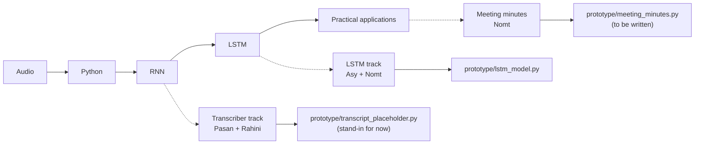

### Team tracks

| Track | People | Builds | Hands off |
|---|---|---|---|
| 1. Transcriber (RNN) | Pasan, Rahini | audio file → speaker-labelled transcript | `get_transcript(audio_path) -> str` |
| 2. LSTM | Asy, Nomt | transcript → hourglass LSTM → 8 numbers per word | `(tokens, 8)` array + turn boundaries |
| 3. Meeting minutes | Nomt | LSTM output → summary and/or action items | minutes text |

The tracks meet at two **contracts**: the transcript string, and the LSTM output array. As long as each side keeps its contract, the tracks can be built in parallel and swapped in without touching each other's code.

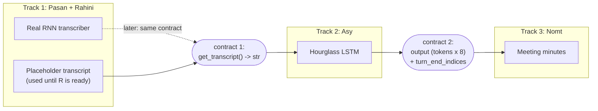

### How the workshop session maps onto the code

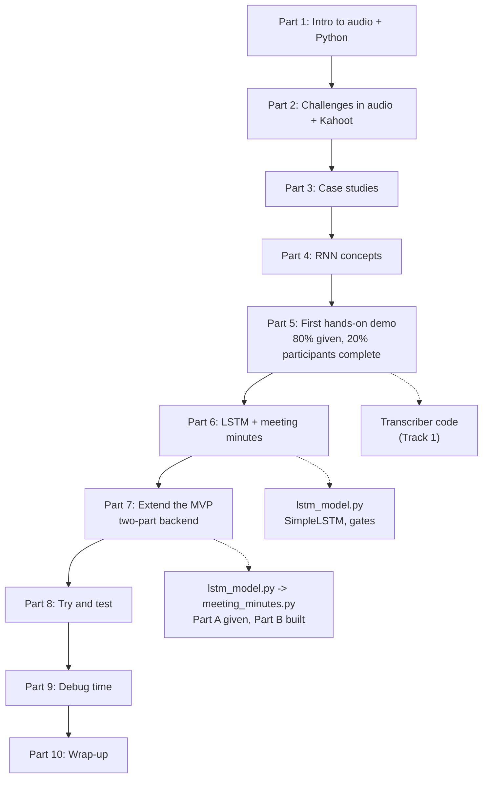

Which 20% participants complete in Part 5, and how the Part 7 backend splits into Part A and Part B, is decided **after** the MVP runs end to end (see [progress.md](progress.md)).

### Three-weekend build plan

Dates assume the weekends of 26 Sep, 3 Oct and 10 Oct. Adjust them in this file if the team's calendar differs.

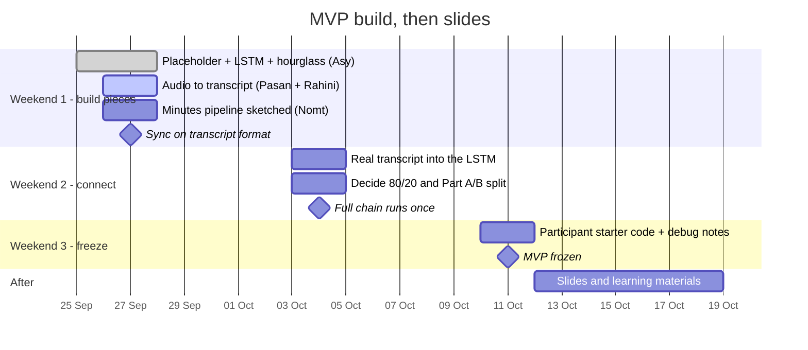

### Definition of done before slide planning starts

- [ ] Audio → transcript → meeting minutes runs end to end without manual steps
- [ ] The 80/20 hands-on split is testable by someone who isn't Pasan or Rahini
- [ ] The Part A/B extension is testable by someone who isn't Asy or Nomt
- [ ] Known failure modes are written down for debug time
- [ ] All four team members have run the full pipeline themselves

---

## Architecture

### Repository layout

```text
mlda-audio-workshop/
├── README.md                          you are here
├── progress.md                        Asy's LSTM-track progress tracker
├── requirements.txt                   numpy
└── prototype/
    ├── transcript_placeholder.py      stand-in for the transcriber (Track 1)
    └── lstm_model.py                  tokenize, embed, 5-layer hourglass LSTM (Track 2)
```

`prototype/meeting_minutes.py` does not exist yet. Nomt owns it.

### End-to-end data flow

One run of `python prototype/lstm_model.py`:

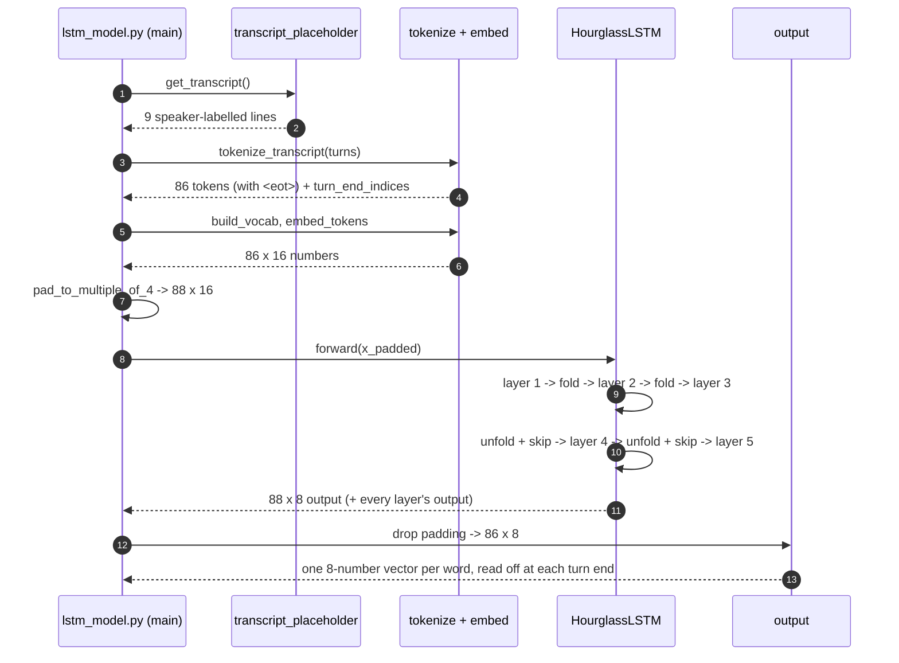

### Module interfaces

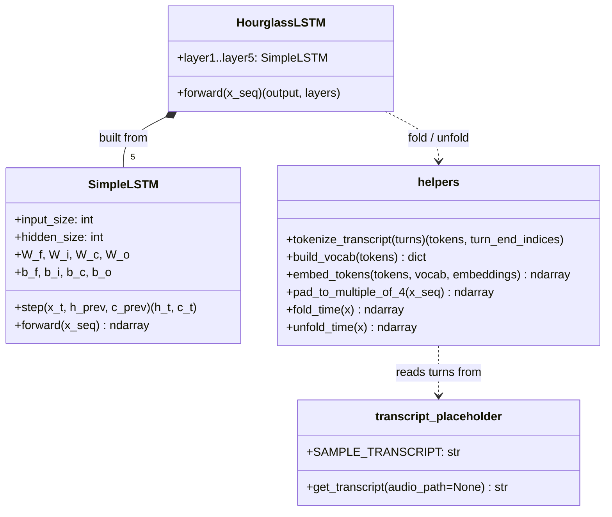

### Step 1: words become numbers

A computer can only do maths on numbers, so each word goes through three steps. Split the text into words, give each unique word an id, then swap the id for a row of 16 numbers from an embedding table.

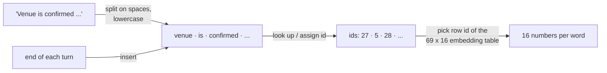

- **Vocabulary:** 69 unique tokens, including the `<eot>` end-of-turn marker.
- **Embeddings:** random for now (seed 42). Training would move words used in similar ways closer together.
- **The whole conversation is one sequence.** The LSTM never resets between speakers; `<eot>` is how it can tell a new person is talking.

### Step 2: the hourglass LSTM

Adapted from Li et al. (2024) (see [References](#references)). Going down, each layer **halves the time steps and doubles the units**; coming back up, it reverses. Skip connections carry early detail across to the later layers.


| Layer | Our units | Our time steps | Paper units | Paper time steps |
|---|---|---|---|---|
| 1 | 8 | 88 | 256 | 512 |
| 2 | 16 | 44 | 512 | 256 |
| 3 | 32 | 22 | 1024* | 128 |
| 4 | 16 | 44 | 512 | 256 |
| 5 | 8 | 88 | 256 | 512 |

\* The paper prints 1014. Every other layer is exactly double or half its neighbour, so 1024 is almost certainly what was meant.

**Why folding loses nothing:** 4 time steps of 2 numbers become 2 time steps of 4 numbers. The numbers are the same, just arranged in fewer, longer rows. `unfold_time()` reverses it exactly, and the script checks this before it runs.

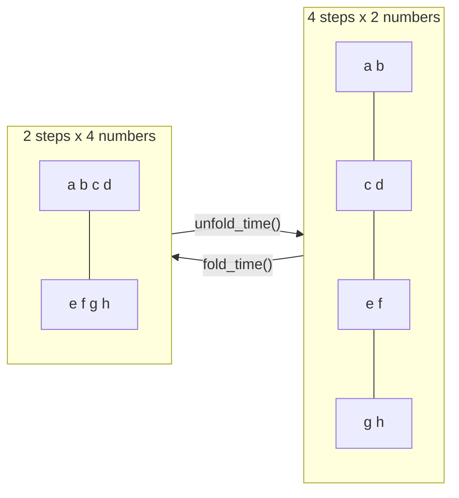

**Why the hourglass helps memory:** in layer 3, one step covers 4 words, so information crosses the whole conversation in 22 steps instead of 88. Every step multiplies stored memory by the forget gate *f*, so fewer steps means more survives. For example, "catering still pending" (turn 4) is 47 words before the end of the meeting:

| Forget gate f | Left in layer 1 (f^47) | Left in layer 3 (f^11.75) |
|---|---|---|
| 0.49 (our untrained gates) | about 0% | 0.02% |
| 0.95 (a trained gate) | 9% | 55% |

### Step 3: inside one LSTM step

All five layers are built from the same `SimpleLSTM.step()`. At every word, four small networks (gates) read the previous output `h(t-1)` joined with the current word `x(t)`:

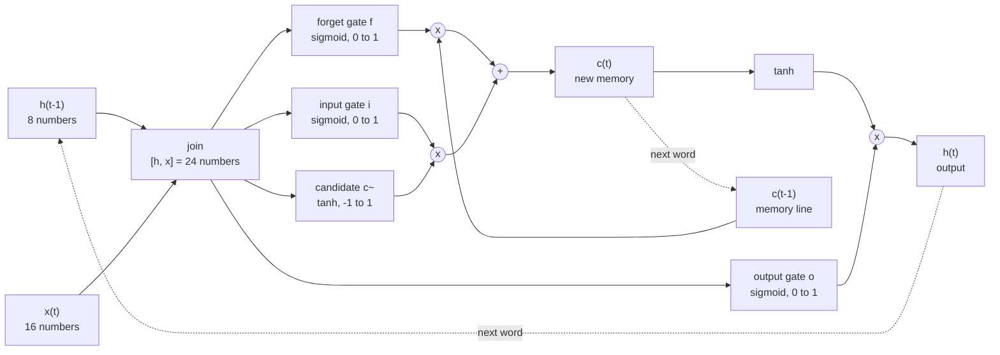

```text
f_t  = sigmoid(W_f · [h_prev, x_t] + b_f)     what to keep
i_t  = sigmoid(W_i · [h_prev, x_t] + b_i)     how much to write
c~_t = tanh(W_c · [h_prev, x_t] + b_c)        what could be written
c_t  = f_t * c_prev + i_t * c~_t              update the memory line
o_t  = sigmoid(W_o · [h_prev, x_t] + b_o)     how much to show
h_t  = o_t * tanh(c_t)                        output for this word
```

Each gate has an 8 x 24 weight grid plus 8 biases: 800 numbers in layer 1 and 13,888 across all five layers. They are random until the model is trained, which is why every gate currently sits near 0.5.

### Component status

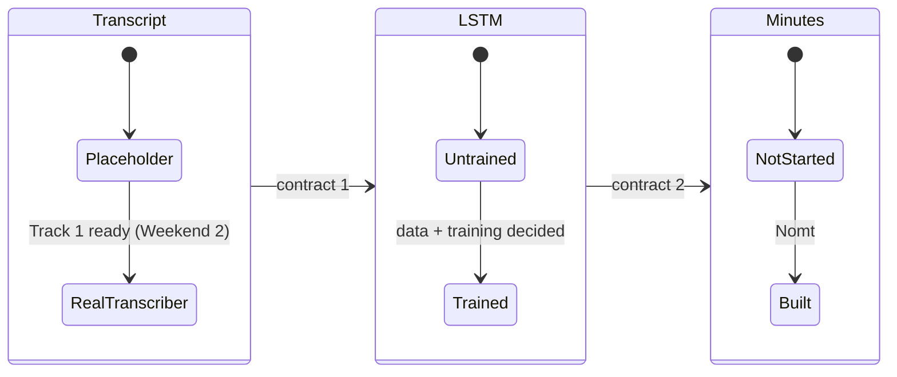

Current state: **Placeholder**, **Untrained**, **NotStarted**.

---

## Key commands

### Run

| What | Command |
|---|---|
| Install the one dependency | `pip install -r requirements.txt` |
| Run the whole prototype | `python prototype/lstm_model.py` |
| Print the placeholder transcript only | `python prototype/transcript_placeholder.py` |
| Check numpy is available | `python -c "import numpy; print(numpy.__version__)"` |

### Google Colab (free tier)

The repo is private, so the simplest route in Colab is to upload the two files:

1. Open a new notebook at colab.research.google.com.
2. In the Files panel on the left, upload `transcript_placeholder.py` and `lstm_model.py` (both are needed; one imports the other).
3. Run in a cell:

```python
!python lstm_model.py
```

numpy is preinstalled on Colab, and the CPU runtime is enough.

### Git workflow

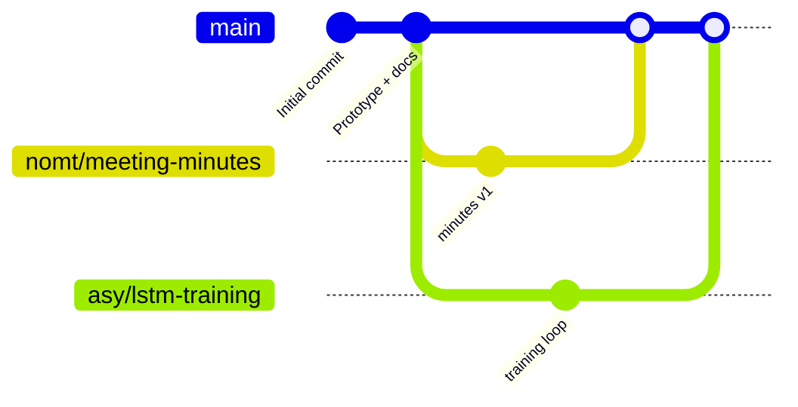

```bash
# once
git clone https://github.com/Asyxddiq/mlda-audio-workshop.git
cd mlda-audio-workshop

# every time you start working
git checkout main
git pull

# work on your own branch
git checkout -b yourname/short-topic      # e.g. nomt/meeting-minutes
# ...edit files...
python prototype/lstm_model.py            # make sure it still runs
git add prototype/your_file.py
git commit -m "Short description of the change"
git push -u origin yourname/short-topic

# then open a Pull Request on GitHub and ask a teammate to review
```

Conventions:

- One branch per person per topic: `asy/...`, `nomt/...`, `pasan/...`, `rahini/...`.
- Run `python prototype/lstm_model.py` before every push. If it breaks, fix it before merging.
- Keep the two contracts stable (`get_transcript() -> str`, and the `(tokens, 8)` LSTM output). If one has to change, tell the other track first.
- Update [progress.md](progress.md) when you finish something.

---

## Simplifications and known limitations

| Limitation | Why it's fine for now | What changes later |
|---|---|---|
| Weights are random (no training) | Proves shapes and wiring end to end | Choose a task + data, then train |
| Transcript is a hard-coded sample | Lets the LSTM track work before the transcriber exists | Swap in Track 1 behind the same `get_transcript()` |
| No attention gates on the skips (the paper has them) | Plain addition is easier to teach | Optional stretch topic |
| Folding lets a word see up to 3 words ahead | Minutes are written from the full transcript anyway | Only matters for live, word-by-word use |
| Whitespace tokenizer ("14th," keeps its comma) | Simple enough to explain in one slide | Strip punctuation or use a library tokenizer |
| NumPy forward pass only | Gates stay visible as plain maths; runs anywhere | Training may move to PyTorch or Keras on Colab |

---

## Interactive explainers

Two interactive pages walk through this backend with the real numbers from the code:

- **Minutes Pipeline**: the four stages, the hourglass layer by layer, and the output turn by turn.
- **Inside the LSTM Cell**: one word at a time through the six steps of `SimpleLSTM.step()`, plus a forget-gate memory demo.

They are private to Asy until shared, so ask Asy for the links.

---

## References

- Li Z, Basit A, Daraz A, Jan A (2024). *Deep causal speech enhancement and recognition using efficient long-short term memory Recurrent Neural Network.* PLOS ONE 19(1): e0291240. https://doi.org/10.1371/journal.pone.0291240
  - Used for: the hourglass layer layout (their Table 1 and Fig 2), lossless reshaping between layers, and skip connections. The paper applies it to cleaning noisy speech; we apply the same shape to transcript tokens.

## Team

MLDA Academics: Asy (Main Comm, LSTM), Nomt (LSTM, meeting minutes), Pasan and Rahini (RNN transcriber).
