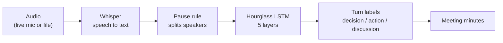
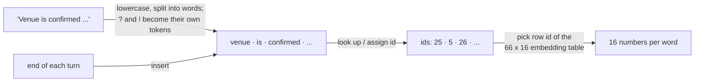
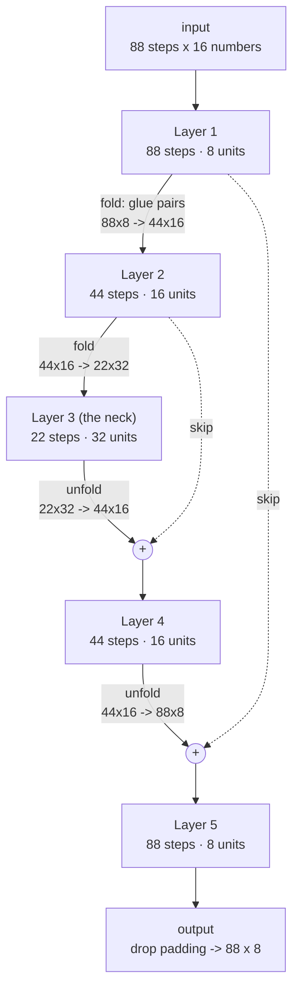
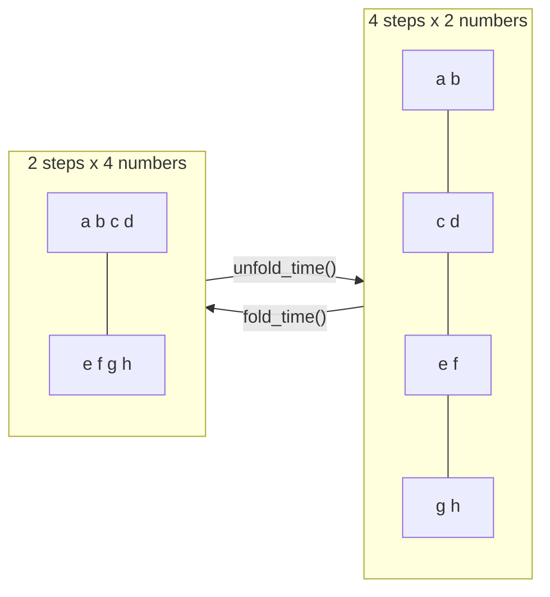
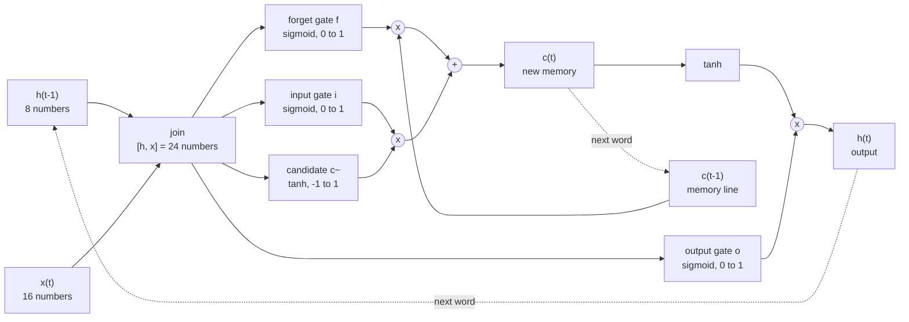

# Deep Learning in Audio Applications: Workshop 4

MLDA@EEE Learnova Workshop 4, NTU, 22 Oct 2026. Final deliverable: the participants' notebook, the opening demo, and the prototype behind them.

## What the workshop aimed to do

Show beginners how AI turns speech into text and then **remembers context** in a conversation, using one running example: turning a meeting into minutes.

- **Sound to words.** Waveforms, spectrograms, and Whisper transcribing live speech, including where it breaks (noise, poor mics, accents).
- **RNNs.** Memory as a running summary, written by participants in one line, then switched off to show where the memory lives, and why simple memory fades in a long conversation.
- **LSTMs.** A memory with an eraser, a pencil and a voice (forget, input and output gates), with a knob participants turn to see what is kept and what is lost.
- **Meeting minutes.** A trained model labels each turn as a decision, an action item or discussion, and writes the minutes. Participants test it on their own spoken meeting and catch its mistakes.

Every theory block has live-mic cells: participants say a prompt, see the result, and connect it back to the theory.

## Architecture



Whisper does the audio-to-text step. Our own model, a small NumPy hourglass LSTM trained on hand-written meetings, reads the words and labels each turn. Rule-based code then writes the minutes, with owners and due dates.

### Step 1: words become numbers

A computer can only do maths on numbers, so each word goes through three steps. Split the text into words, give each unique word an id, then swap the id for a row of 16 numbers from an embedding table.



- **Vocabulary:** 66 unique tokens in the sample meeting, including the `<eot>` end-of-turn marker. The trained model uses a fixed 553-word vocabulary from its training data instead, and any word outside it becomes `<unk>`.
- **Embeddings:** random in this walk-through (seed 42). In the trained model they are learned along with everything else.
- **The whole conversation is one sequence.** The LSTM never resets between speakers; `<eot>` is how it can tell a new person is talking.

### Step 2: the hourglass LSTM

Adapted from Li et al. (2024) (see [References](#references)). Going down, each layer **halves the time steps and doubles the units**; coming back up, it reverses. Skip connections carry early detail across to the later layers.



| Layer | Our units | Our time steps | Paper units | Paper time steps |
|---|---|---|---|---|
| 1 | 8 | 88 | 256 | 512 |
| 2 | 16 | 44 | 512 | 256 |
| 3 | 32 | 22 | 1024* | 128 |
| 4 | 16 | 44 | 512 | 256 |
| 5 | 8 | 88 | 256 | 512 |

\* The paper prints 1014. Every other layer is exactly double or half its neighbour, so 1024 is almost certainly what was meant.

**Why folding loses nothing:** 4 time steps of 2 numbers become 2 time steps of 4 numbers. The numbers are the same, just arranged in fewer, longer rows. `unfold_time()` reverses it exactly, and the script checks this before it runs.



**Why the hourglass helps memory:** in layer 3, one step covers 4 words, so information crosses the whole conversation in 22 steps instead of 88. Every step multiplies stored memory by the forget gate *f*, so fewer steps means more survives. For example, "catering still pending" (turn 4) is 47 words before the end of the meeting:

| Forget gate f | Left in layer 1 (f^47) | Left in layer 3 (f^11.75) |
|---|---|---|
| 0.49 (our untrained gates) | about 0% | 0.02% |
| 0.95 (a trained gate) | 9% | 55% |

### Step 3: inside one LSTM step

All five layers are built from the same `SimpleLSTM.step()`. At every word, four small networks (gates) read the previous output `h(t-1)` joined with the current word `x(t)`:



```text
f_t  = sigmoid(W_f · [h_prev, x_t] + b_f)     what to keep
i_t  = sigmoid(W_i · [h_prev, x_t] + b_i)     how much to write
c~_t = tanh(W_c · [h_prev, x_t] + b_c)        what could be written
c_t  = f_t * c_prev + i_t * c~_t              update the memory line
o_t  = sigmoid(W_o · [h_prev, x_t] + b_o)     how much to show
h_t  = o_t * tanh(c_t)                        output for this word
```

Each gate has an 8 x 24 weight grid plus 8 biases: 800 numbers in layer 1 and 13,888 across all five layers. In `lstm_model.py`'s walk-through they are random, which is why every gate sits near 0.5; `train_lstm.py` learns them.

### The trained model

`prototype/train_lstm.py` trains the hourglass plus a small classifier head with hand-written NumPy backprop, on hand-labelled meetings plus generated practice meetings. The shipped weights (`prototype/trained_lstm.npz`) are a 5-seed ensemble.

| Measure | Trained LSTM | Keyword rules |
|---|---|---|
| Test accuracy (45 turns) | 0.84 | 0.69 |
| Held-out scorecard accuracy (105 turns) | 0.90 | 0.76 |
| Cross-turn probes ("Sure." after a request vs a proposal) | 9 / 12 | 3 / 12 |

Known limits: it misses decisions stated as plain facts ("Venue is confirmed for the 14th"), uses about one previous turn of context (no clear gain over a plain RNN on this task), and all data was written by the team.

## Repository layout

```text
notebook/    the participants' Colab notebook, its helpers, audio clips, cheat sheet and zips
demo/        the opening "who remembers the meeting?" demo: notebook, script, answer key, facilitator guide, run sheet
prototype/   the pipeline: transcriber, hourglass LSTM, training, minutes, hands-on code, data and tests
labelling_guide.md   how meeting turns were labelled
```

## How to run it

**On Google Colab (as in the workshop):**
1. Upload `notebook/audio_workshop.ipynb` (File > Upload notebook) and set Runtime > Change runtime type > T4 GPU.
2. Drag `notebook/workshop_files.zip` into the Files panel and run the setup cell.
3. For the opening demo, do the same with `demo/hook_demo.ipynb` and `notebook/facilitator_files.zip`, and follow `demo/FACILITATOR.md`.

**On a laptop:**
```bash
pip install -r requirements.txt openai-whisper
python prototype/pipeline.py              # sample meeting, typed, no audio needed
python prototype/pipeline.py meeting.wav  # your own recording (needs ffmpeg)
python prototype/run_tests.py             # all checks
python notebook/make_bundle.py            # rebuild the Colab zips
```

## References

- Li Z, Basit A, Daraz A, Jan A (2024). *Deep causal speech enhancement and recognition using efficient long-short term memory Recurrent Neural Network.* PLOS ONE 19(1): e0291240. https://doi.org/10.1371/journal.pone.0291240
  - Used for: the hourglass layer layout (their Table 1 and Fig 2), lossless reshaping between layers, and skip connections. The paper applies it to cleaning noisy speech; we apply the same shape to transcript tokens.

## Team

MLDA Academics: Asy (Main Comm, LSTM), Nomt (LSTM, meeting minutes), Pasan and Rahini (RNN transcriber).

