# mlda-audio-workshop

Backend prototype for the MLDA Academics workshop **Deep Learning in Audio Applications**.

The pipeline is audio → transcript → LSTM → meeting minutes. It is written as small, readable NumPy code so that beginner-to-intermediate participants can follow every step and run it on free Google Colab.

| Component | Owner | Status (8 Oct 2026) |
|---|---|---|
| Real audio → transcript (Whisper, pause-based speakers) | Pasan, Rahini | Works on synthetic speech since the 8 Oct fix; human recording still to test. A reply under 0.8 s can still be merged; more than two speakers are not told apart |
| RNN + CTC teaching demo | Pasan, Rahini | Working |
| 5-layer hourglass LSTM | Asy | Working |
| Training data: 12 hand-labelled meetings (230 turns) + 60 generated practice meetings | Asy (draft), Nomt checked his half 8 Oct | Draft; blind cross-check to do |
| Trained turn classifier (`train_lstm.py`, NumPy) | Asy | Retrained 8 Oct with more decision examples; beats keyword rules on held-out meetings, but scores lower than the first version (see [results](#step-4-training-the-classifier)) |
| Meeting minutes (trained labels, keyword fallback) | Nomt | Working |
| Whole chain in one command (`pipeline.py`) | All | Working on the sample meeting |

**Contents:** [Quick start](#quick-start) · [High-level alignment](#high-level-alignment) · [Architecture](#architecture) · [Key commands](#key-commands) · [Limitations](#simplifications-and-known-limitations) · [References](#references)

---

## Quick start

```bash
git clone https://github.com/Asyxddiq/mlda-audio-workshop.git
cd mlda-audio-workshop
pip install -r requirements.txt
python prototype/lstm_model.py
```

Expected output (abridged):

```text
Vocab size: 66 words (incl. <eot>)
Tokens in conversation: 88 (padded to 88 so it divides by 4)
Fold -> unfold round trip is lossless: True

Hourglass shape (compare with the paper's Table 1):
  layer      units   time steps
  layer 1        8           88
  layer 2       16           44
  layer 3       32           22
  layer 4       16           44
  layer 5        8           88

[Alex] Let's kick off. First item is the Q3 budget review.
  -> output after this turn (first 4 of 8 dims): [0.008 0.016 0.017 0.006]
...
```

The only dependency is `numpy`. No GPU is needed; the full run takes well under a second.

To run the whole chain (transcript → LSTM → minutes) in one go:

```bash
python prototype/pipeline.py                # sample meeting, no audio needed
python prototype/pipeline.py meeting.wav    # real audio: pip install openai-whisper, plus ffmpeg
python prototype/pipeline.py --meeting hackathon_1 --compare   # a hand-labelled meeting, hand labels alongside
```

The trained weights (`prototype/trained_lstm.npz`) are in the repo, so the pipeline labels turns with the trained model straight away. To retrain them from [`training_data.py`](prototype/training_data.py) (a few minutes on a laptop CPU, numpy only):

```bash
python prototype/train_lstm.py
```

---

## High-level alignment

### Where this repo sits in the learning arc

The workshop teaches **Audio → Python → RNN → LSTM → Practical applications**. Each stage of the arc has an owner and a piece of this repo.

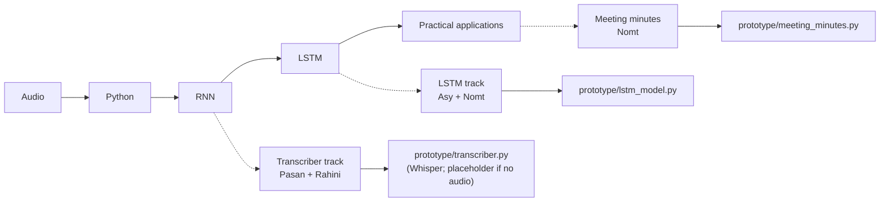

### Team tracks

| Track | People | Builds | Hands off |
|---|---|---|---|
| 1. Transcriber (RNN) | Pasan, Rahini | audio file → speaker-labelled transcript | `get_transcript(audio_path) -> str` |
| 2. LSTM | Asy, Nomt | transcript → hourglass LSTM → 8 numbers per word | `(tokens, 8)` array + turn boundaries |
| 3. Meeting minutes | Nomt | LSTM output → summary and/or action items | minutes text |

The tracks meet at two **contracts**: the transcript string, and the LSTM output array. As long as each side keeps its contract, the tracks can be built in parallel and swapped in without touching each other's code.


### How the workshop session maps onto the code

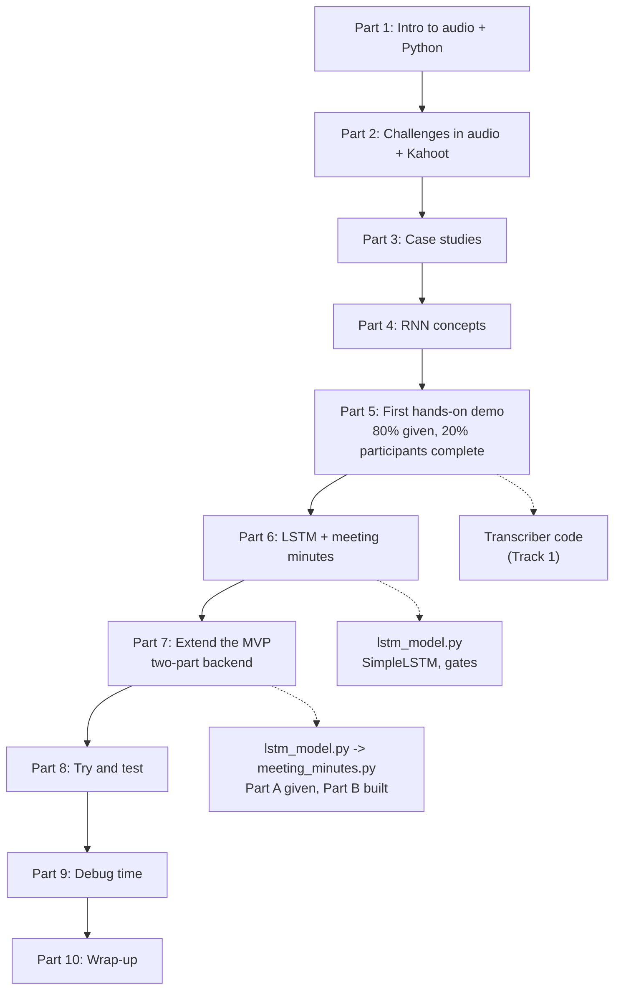

Which 20% participants complete in Part 5, and how the Part 7 backend splits into Part A and Part B, is decided **after** the MVP runs end to end (see [progress.md](progress.md)).

### Three-weekend build plan

Dates assume the weekends of 26 Sep, 3 Oct and 10 Oct. Adjust them in this file if the team's calendar differs.

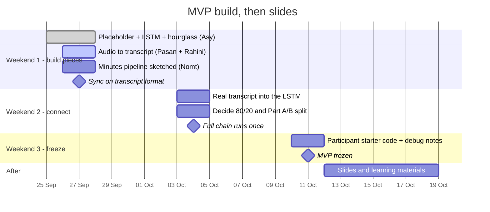

### Definition of done before slide planning starts

- [ ] Audio → transcript → meeting minutes runs end to end without manual steps
- [ ] The 80/20 hands-on split is testable by someone who isn't Pasan or Rahini
- [ ] The Part A/B extension is testable by someone who isn't Asy or Nomt
- [ ] Known failure modes are written down for debug time
- [ ] All four team members have run the full pipeline themselves

---

## Architecture

### Repository layout

```text
mlda-audio-workshop/
├── README.md                          you are here
├── progress.md                        Asy's LSTM-track progress tracker
├── labelling_guide.md                 rules for labelling training turns
├── requirements.txt                   numpy
└── prototype/
    ├── pipeline.py                    whole chain in one command (start here)
    ├── transcriber.py                 audio → transcript with Whisper (Track 1)
    ├── transcript_placeholder.py      sample meeting, used when no audio is given
    ├── rnn_ctc_demo.py                RNN + CTC teaching demo (Part 5)
    ├── lstm_model.py                  tokenize, embed, 5-layer hourglass LSTM (Track 2)
    ├── meeting_minutes.py             label turns, write Markdown minutes (Track 3)
    ├── training_data.py               hand-labelled meetings, probe set, practice-meeting generator
    ├── train_lstm.py                  trains the hourglass + classifier head (NumPy backprop)
    ├── trained_lstm.npz               the trained weights (made by train_lstm.py)
    └── train_classifier.py            earlier PyTorch scaffold (Nomt), kept for reference
```

### End-to-end data flow

One run of `python prototype/lstm_model.py`:

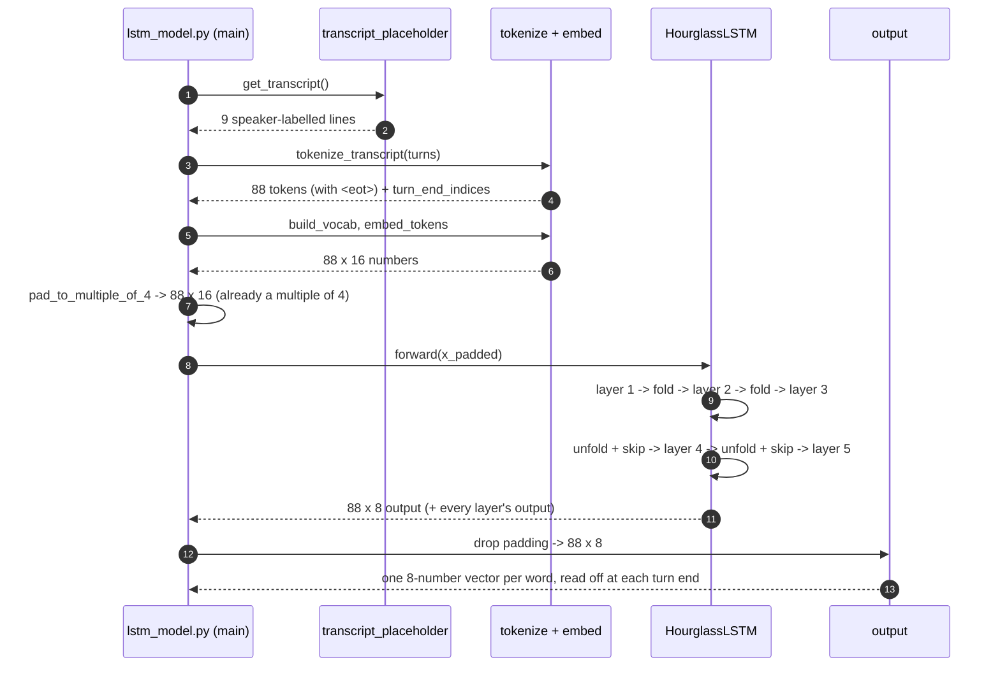

### Module interfaces

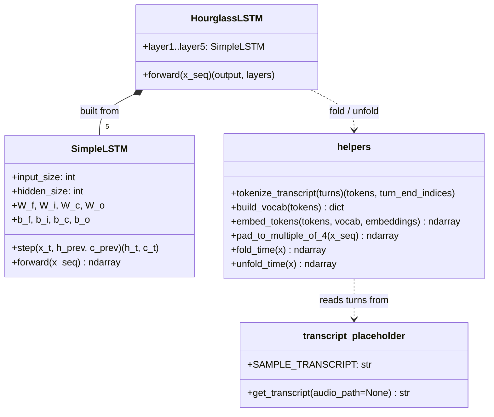

### Step 1: words become numbers

A computer can only do maths on numbers, so each word goes through three steps. Split the text into words, give each unique word an id, then swap the id for a row of 16 numbers from an embedding table.

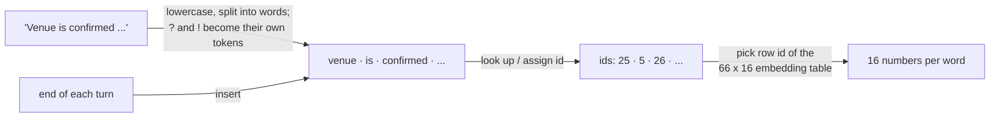

- **Vocabulary:** 66 unique tokens in the sample meeting, including the `<eot>` end-of-turn marker. The trained model uses a fixed 424-word vocabulary from its training data instead, and any word outside it becomes `<unk>`.
- **Embeddings:** random in this walk-through (seed 42). In the trained model they are learned along with everything else.
- **The whole conversation is one sequence.** The LSTM never resets between speakers; `<eot>` is how it can tell a new person is talking.

### Step 2: the hourglass LSTM

Adapted from Li et al. (2024) (see [References](#references)). Going down, each layer **halves the time steps and doubles the units**; coming back up, it reverses. Skip connections carry early detail across to the later layers.

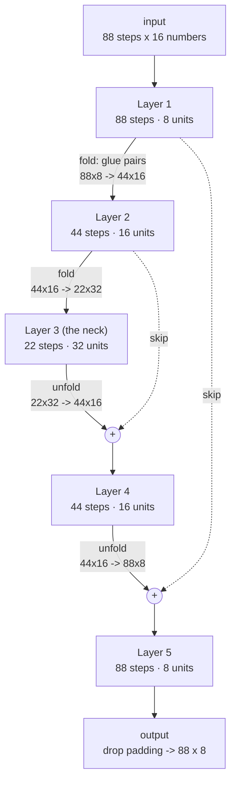

| Layer | Our units | Our time steps | Paper units | Paper time steps |
|---|---|---|---|---|
| 1 | 8 | 88 | 256 | 512 |
| 2 | 16 | 44 | 512 | 256 |
| 3 | 32 | 22 | 1024* | 128 |
| 4 | 16 | 44 | 512 | 256 |
| 5 | 8 | 88 | 256 | 512 |

\* The paper prints 1014. Every other layer is exactly double or half its neighbour, so 1024 is almost certainly what was meant.

**Why folding loses nothing:** 4 time steps of 2 numbers become 2 time steps of 4 numbers. The numbers are the same, just arranged in fewer, longer rows. `unfold_time()` reverses it exactly, and the script checks this before it runs.

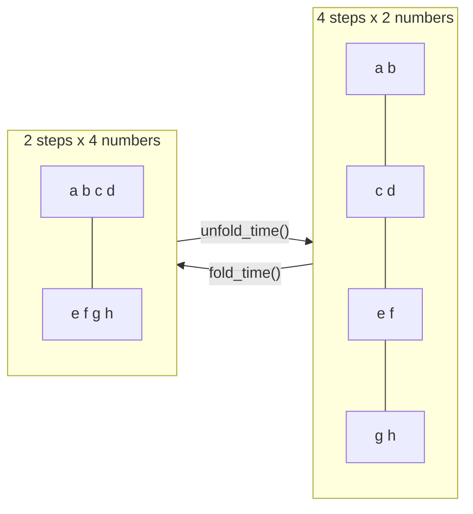

**Why the hourglass helps memory:** in layer 3, one step covers 4 words, so information crosses the whole conversation in 22 steps instead of 88. Every step multiplies stored memory by the forget gate *f*, so fewer steps means more survives. For example, "catering still pending" (turn 4) is 47 words before the end of the meeting:

| Forget gate f | Left in layer 1 (f^47) | Left in layer 3 (f^11.75) |
|---|---|---|
| 0.49 (our untrained gates) | about 0% | 0.02% |
| 0.95 (a trained gate) | 9% | 55% |

### Step 3: inside one LSTM step

All five layers are built from the same `SimpleLSTM.step()`. At every word, four small networks (gates) read the previous output `h(t-1)` joined with the current word `x(t)`:

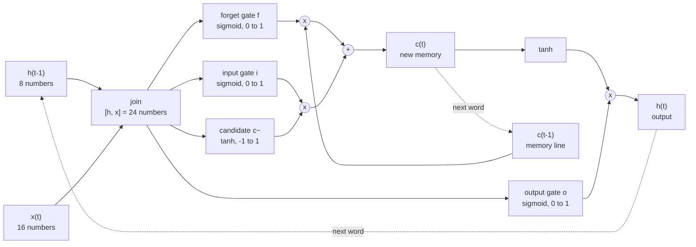

```text
f_t  = sigmoid(W_f · [h_prev, x_t] + b_f)     what to keep
i_t  = sigmoid(W_i · [h_prev, x_t] + b_i)     how much to write
c~_t = tanh(W_c · [h_prev, x_t] + b_c)        what could be written
c_t  = f_t * c_prev + i_t * c~_t              update the memory line
o_t  = sigmoid(W_o · [h_prev, x_t] + b_o)     how much to show
h_t  = o_t * tanh(c_t)                        output for this word
```

Each gate has an 8 x 24 weight grid plus 8 biases: 800 numbers in layer 1 and 13,888 across all five layers. In `lstm_model.py`'s walk-through they are random, which is why every gate sits near 0.5; `train_lstm.py` learns them.

### Step 4: training the classifier

`train_lstm.py` teaches the hourglass to label each turn as **discussion**, **decision** or **action_item**. It trains the same network `lstm_model.py` runs, plus a small head on top, and saves the weights in the same shapes, so `lstm_model.py` loads them directly.

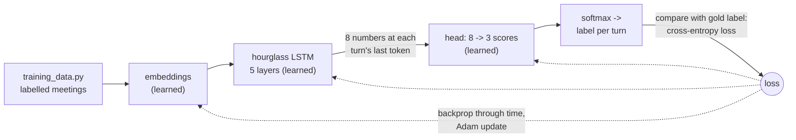

| Data | Meetings | Turns | Used for |
|---|---|---|---|
| Hand-written: group project, lab stand-up, CCA committee, club event, orientation planning | 8 | 165 | training |
| Generated practice meetings (phrase lists in `training_data.py`) | 60 | 553 | training only |
| Hand-written: club event (a follow-up to a training meeting, so dev scores run a bit optimistic) | 1 | 20 | dev: picks the best epoch and seed |
| Hand-written: group project, hackathon, the sample meeting | 3 | 45 | **test**, scored once |
| Probe set: bare replies ("Sure.", "Okay.") after a request, a proposal or plain information | 12 | 12 replies | **cross-turn test**, never trained on |

Results on the held-out data (seed chosen by dev loss before looking at test):

| Labeller | Test accuracy | Test macro-F1 | Probes correct |
|---|---|---|---|
| **Trained hourglass LSTM** | **0.76** | **0.74** | **9 / 12** |
| Keyword rules | 0.69 | 0.59 | 3 / 12 |
| Always "discussion" | 0.56 | 0.24 | 3 / 12 |

- The keyword lists were written while looking at the sample meeting, which flatters them there. On the two test meetings nobody looked at while writing rules (36 turns): model 0.78 accuracy / 0.77 macro-F1, keyword rules 0.64 / 0.50.
- Across the 5 seeds trained, test accuracy ranged from 0.76 to 0.82 (mean 0.79; macro-F1 mean 0.77). With this little data the starting weights matter a lot, so all five scores are printed every run.
- What it gets right that keywords can't: "Sure." after "Kai, you handle the judging rubric" (action item) vs "Makes sense." after "How about we split the prizes?" (decision) vs "Okay." after "The bus was late again" (discussion).
- What it still misses: decisions reported as facts ("Venue is confirmed for the 14th"), 4 of the 10 test decisions, and it calls 5 discussion turns decisions. On the sample meeting it gets 6 of 9 turns right: it finds the action item but neither decision, and it calls "Good, let's keep monitoring that." a decision.
- These are the numbers after the 8 Oct retrain, which added decision-as-fact examples to the training data. The first version scored higher on test (0.84 / 0.82; 0.86 / 0.85 on the two untouched meetings; 7 of 9 on the sample meeting) but varied more between seeds (0.69 to 0.84). The rule for "better" was written before retraining and judged on dev: get the dev meeting's reported confirmation right without losing anything else. The new model passed it (dev 1.00), yet scored lower on held-out data, because a single 20-turn dev meeting is too small to choose between models. We kept the retrained version; details in [progress.md](progress.md).
- A separate review checked the first 211 hand-written labels against the rules and looked for test sentences leaking into training; `python prototype/training_data.py` re-runs the leak check (no probe or test sentence shares 5 words in a row with the training data).

### Component status

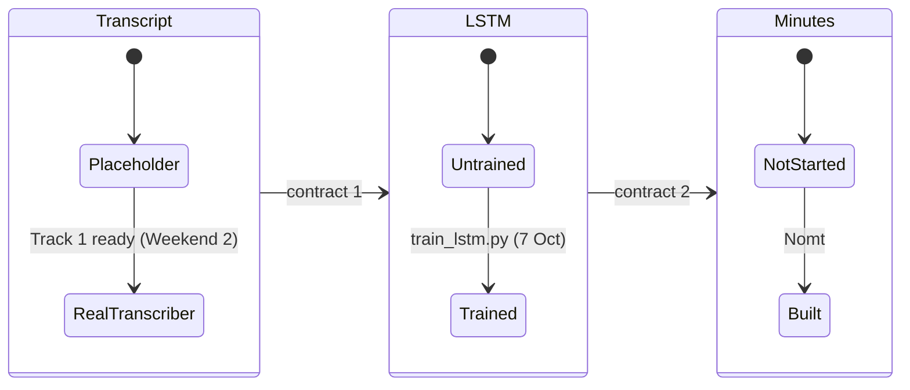

Current state: transcript **RealTranscriber** (Whisper, falling back to the placeholder when no audio is given), LSTM **Trained**, minutes **Built** on the trained model's labels (keyword rules if the weights file is missing).

---

## Key commands

### Run

| What | Command |
|---|---|
| Install the one dependency | `pip install -r requirements.txt` |
| Run the whole chain | `python prototype/pipeline.py` |
| Run it on real audio | `python prototype/pipeline.py meeting.wav` (needs `pip install openai-whisper` and ffmpeg) |
| Compare keyword rules with the trained LSTM | `python prototype/pipeline.py --compare` (shows both labels for every turn; also works with `meeting.wav`) |
| Run a hand-labelled meeting | `python prototype/pipeline.py --meeting hackathon_1 --compare` (any meeting name in `training_data.py`; adds the hand labels to the comparison) |
| Run the LSTM stage only | `python prototype/lstm_model.py` |
| Train the LSTM classifier | `python prototype/train_lstm.py` (numpy only, a few minutes) |
| Check the training data | `python prototype/training_data.py` |
| Earlier PyTorch scaffold | `python prototype/train_classifier.py` (needs `pip install torch`) |
| RNN + CTC teaching demo | `python prototype/rnn_ctc_demo.py` |
| Print the placeholder transcript only | `python prototype/transcript_placeholder.py` |
| Check numpy is available | `python -c "import numpy; print(numpy.__version__)"` |

### Google Colab (free tier)

The repo is private, so the simplest route in Colab is to upload the files:

1. Open a new notebook at colab.research.google.com.
2. In the Files panel on the left, upload `transcript_placeholder.py`, `transcriber.py` and `lstm_model.py` (`lstm_model.py` imports the other two). Add `trained_lstm.npz` too if you want the trained weights.
3. Run in a cell:

```python
!python lstm_model.py
```

numpy is preinstalled on Colab, and the CPU runtime is enough.

### Git workflow

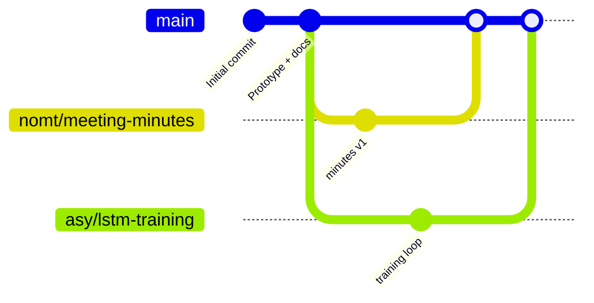

```bash
# once
git clone https://github.com/Asyxddiq/mlda-audio-workshop.git
cd mlda-audio-workshop

# every time you start working
git checkout main
git pull

# work on your own branch
git checkout -b yourname/short-topic      # e.g. nomt/meeting-minutes
# ...edit files...
python prototype/lstm_model.py            # make sure it still runs
git add prototype/your_file.py
git commit -m "Short description of the change"
git push -u origin yourname/short-topic

# then open a Pull Request on GitHub and ask a teammate to review
```

Conventions:

- One branch per person per topic: `asy/...`, `nomt/...`, `pasan/...`, `rahini/...`.
- Run `python prototype/lstm_model.py` before every push. If it breaks, fix it before merging.
- Keep the two contracts stable (`get_transcript() -> str`, and the `(tokens, 8)` LSTM output). If one has to change, tell the other track first.
- Update [progress.md](progress.md) when you finish something.

---

## Simplifications and known limitations

| Limitation | Why it's fine for now | What changes later |
|---|---|---|
| Training data is small and mostly written by us (230 hand-written turns + generated practice meetings) | Enough to show training works and beats keyword rules | Blind cross-check, then add real meetings |
| Transcript is a hard-coded sample | Lets the LSTM track work before the transcriber exists | Swap in Track 1 behind the same `get_transcript()` |
| No attention gates on the skips (the paper has them) | Plain addition is easier to teach | Optional stretch topic |
| Folding lets a word see up to 3 words ahead | Minutes are written from the full transcript anyway | Only matters for live, word-by-word use |
| Simple tokenizer: lowercase words, `?` and `!` as tokens, other punctuation dropped | Simple enough to explain in one slide | A library tokenizer, if ever needed |
| Training is hand-written NumPy backprop, not a framework | No port between frameworks; one dependency; checked against numerical gradients | PyTorch scaffold (`train_classifier.py`) is there if we switch |
| The trained model misses some decisions (reported confirmations like "Venue is confirmed") | Visible, honest failure case for *Try and test* | Some added 8 Oct (held-out scores dropped; see results). Next: a bigger dev set, then examples from real meetings |

---

## Interactive explainers

Two interactive pages walk through this backend with the real numbers from the code:

- **Minutes Pipeline**: the four stages, the hourglass layer by layer, and the output turn by turn.
- **Inside the LSTM Cell**: one word at a time through the six steps of `SimpleLSTM.step()`, plus a forget-gate memory demo.

They are private to Asy until shared, so ask Asy for the links.

---

## References

- Li Z, Basit A, Daraz A, Jan A (2024). *Deep causal speech enhancement and recognition using efficient long-short term memory Recurrent Neural Network.* PLOS ONE 19(1): e0291240. https://doi.org/10.1371/journal.pone.0291240
  - Used for: the hourglass layer layout (their Table 1 and Fig 2), lossless reshaping between layers, and skip connections. The paper applies it to cleaning noisy speech; we apply the same shape to transcript tokens.

## Team

MLDA Academics: Asy (Main Comm, LSTM), Nomt (LSTM, meeting minutes), Pasan and Rahini (RNN transcriber).
