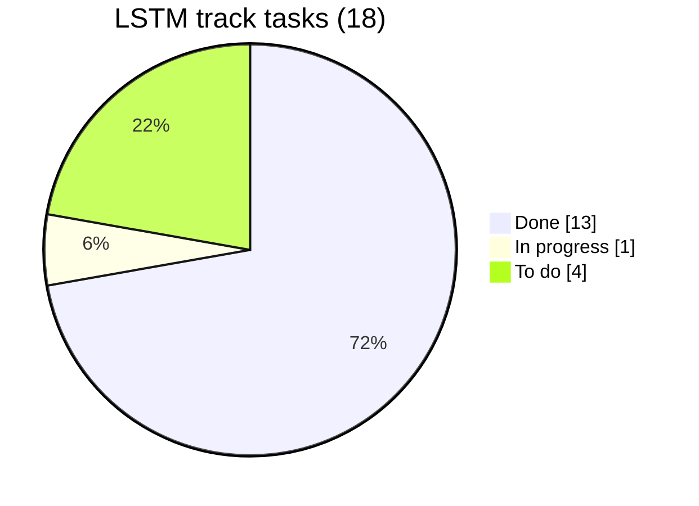
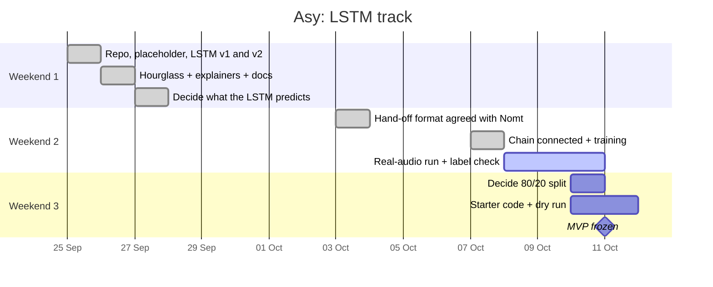
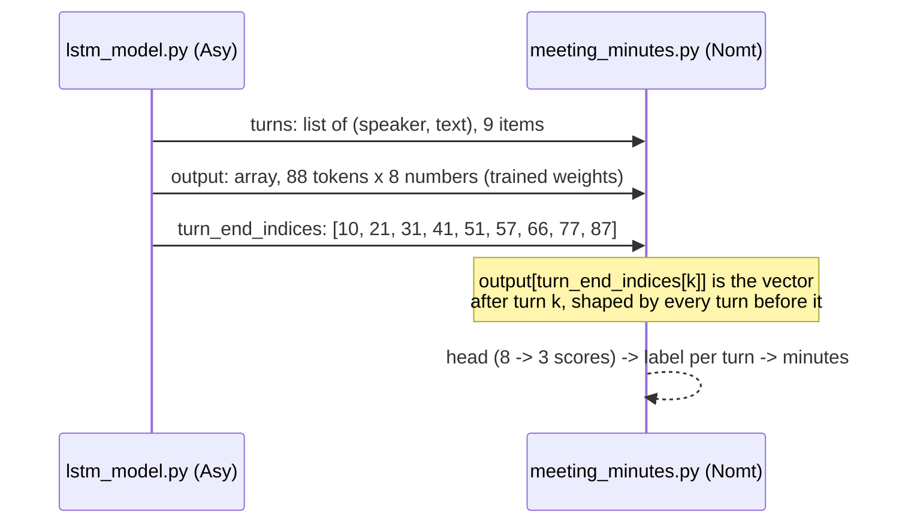

# Progress: Asy (LSTM track)

| | |
|---|---|
| **Owner** | Asy |
| **Track** | 2: LSTM (with Nomt, who owns meeting minutes) |
| **Code** | `prototype/lstm_model.py`, `prototype/train_lstm.py`, `prototype/training_data.py`, `prototype/transcript_placeholder.py` |
| **Last updated** | 8 Oct 2026 |
| **Current phase** | Weekend 2: model retrained with more decision examples, Nomt's label check done; blind cross-check and a human-audio run next |

Update this file whenever something is finished, decided or blocked. Tick the box, add a line to the [log](#log), and move the node in the [roadmap](#roadmap).

---

## At a glance

| Area | Status | Note |
|---|---|---|
| Placeholder transcript | Done | Same contract the real transcriber will use |
| LSTM forward pass | Done | Continuous across all turns |
| Hourglass architecture | Done | 8 / 16 / 32 / 16 / 8, adapted from Li et al. (2024) |
| What the LSTM should learn | Done | Per-turn classifier: action_item / decision / discussion (see [decisions](#decisions)) |
| Labelling guide + rule | Done | Rule locked 7 Oct, clarified 8 Oct; blind cross-check: Nomt 10/10, Asy pending |
| Training data | Done (draft) | 12 hand-labelled meetings (230 turns) + 60 generated practice meetings; Nomt checked his half 8 Oct (no label changes); decision-as-fact examples added 8 Oct |
| Training | Done | `train_lstm.py` (NumPy). Retrained 8 Oct: test accuracy 0.76 vs keyword rules 0.69 (first version 0.84); probes 9/12 vs 3/12 |
| Hand-off to Nomt | Done | `run_pipeline()` loads the trained weights; `label_turns_model()` in `meeting_minutes.py` |
| Real transcriber swap | In progress | Wired up in `pipeline.py`; works on synthetic speech after the 8 Oct transcriber fix; human recording still to do |

---

## Roadmap

```mermaid
flowchart LR
    A["Repo + Nomt added"]:::done --> B["Placeholder transcript"]:::done
    B --> C["LSTM v1<br/>per line"]:::done
    C --> D["LSTM v2<br/>continuous + eot"]:::done
    D --> E["Hourglass LSTM<br/>5 layers"]:::done
    E --> F["Explainers +<br/>README + push"]:::done
    F --> G["Decide what the<br/>LSTM predicts"]:::done
    G --> H["Training data"]:::done
    H --> I["Training"]:::done
    G --> J["Hand-off format<br/>for Nomt"]:::done
    I --> K["Swap in real<br/>transcriber"]:::doing
    J --> K
    K --> L["Decide 80/20 split"]:::todo
    L --> M["Freeze + dry run"]:::todo

    classDef done fill:#dcefe5,stroke:#1f8a5f,color:#1c1d1f
    classDef doing fill:#e4e9fc,stroke:#3457d5,color:#1c1d1f
    classDef todo fill:#f5f4f1,stroke:#9a9ca1,color:#1c1d1f,stroke-dasharray: 4 3
```

Green: done · Blue: in progress · Dashed: to do

---

## Timeline

Weekend dates are assumed (26 Sep, 3 Oct, 10 Oct). Change them here if the team's plan differs.

---

## Checklist

### Weekend 1: build the pieces

- [x] Create private repo `mlda-audio-workshop`, add Nomt as collaborator (25 Sep)
- [x] Placeholder transcript with the `get_transcript(audio_path=None) -> str` contract (25 Sep)
- [x] First NumPy LSTM forward pass, one line at a time (25 Sep)
- [x] Run the LSTM continuously across turns, with `<eot>` markers between speakers (25 Sep)
- [x] Restructure into a 5-layer hourglass LSTM, adapted from Li et al. (2024) (26 Sep)
- [x] Interactive explainers: *Minutes Pipeline* and *Inside the LSTM Cell* (26 Sep)
- [x] README, this tracker, and first push to GitHub (26 Sep)
- [x] Decide what the LSTM should learn (with Nomt): per-turn classifier, action_item / decision / discussion (27 Sep)

### Weekend 2: connect

- [x] Wrap `main` in an importable `run_pipeline()` for the minutes step (27 Sep)
- [x] Scaffold `train_classifier.py`: PyTorch, one hand-labelled meeting, loop runs + times an epoch (27 Sep)
- [x] Lock the action-item rule in the labelling guide: label the request **and** the reply (7 Oct)
- [x] Training data: 11 hand-labelled meetings across group project, lab stand-up, CCA committee, club event, hackathon (211 turns), plus 12 probes and a practice-meeting generator (7 Oct, first draft)
- [x] Train the hourglass + classifier head on it: `train_lstm.py`, NumPy, weights load straight into `lstm_model.py`, no port needed (7 Oct)
- [ ] Blind check: Asy and Nomt each label 10 of the other's turns; tighten the guide where they disagree, then rerun `train_lstm.py` (sheets prepared 8 Oct; Nomt's 10: 10/10 agree; Asy's 10 pending)
- [ ] Swap the placeholder for Track 1's real transcriber and run the full chain once: wired up 7 Oct (`pipeline.py`) and runs on the sample; ran on synthetic text-to-speech audio 8 Oct and works after a transcriber fix (see log); a human recording still to do

### Weekend 3: freeze

- [ ] Decide which 20% participants complete, and the Part A/B split for the extension
- [ ] Write participant starter code and a debug-time cheat sheet
- [ ] Dry run with someone outside the LSTM track, then freeze

---

## Log

### Fri 25 Sep 2026

- Created private repo `Asyxddiq/mlda-audio-workshop`; Nomt added as collaborator.
- Built `transcript_placeholder.py`: a 9-turn sample meeting behind `get_transcript()`, so the LSTM track isn't blocked on the transcriber.
- Built LSTM v1 in plain NumPy (PyTorch wasn't installable in the build sandbox, and NumPy keeps the gates visible for teaching).
- Changed to one continuous pass over the whole conversation. Long-range memory across turns is the reason to teach LSTM at all, and v1 reset state at every line.

### Sat 26 Sep 2026

- Checked the "deep research" summary against the actual paper PDF: the summary described a different CNN + LSTM sound-classification model. Worked from the actual paper instead.
- Adapted the paper's hourglass: 5 layers (8 / 16 / 32 / 16 / 8 units over 88 / 44 / 22 / 44 / 88 steps), lossless fold and unfold, skips 1→5 and 2→4, no attention gates.
- Noted two things in the code: the paper's "1014 units" is almost certainly a typo for 1024, and folding lets a word see up to 3 words ahead (fine for minutes).
- Built two interactive explainers using the real numbers from the run.
- Wrote README and this tracker; pushed prototype to GitHub.
- Observation: with random weights every forget gate sits near 0.49, so almost nothing survives 47 words in layer 1. Training is what would fix this. It's a good example for the workshop.

### Sun 27 Sep 2026

- Settled the core plan with Asy (see [decisions](#decisions)): train the hourglass **itself** as a per-turn classifier (action_item / decision / discussion), keyword rules first as baseline + fallback, PyTorch on Colab for training with NumPy kept for the teaching forward pass.
- Added `run_pipeline()` to `lstm_model.py` (importable hand-off) and a first `meeting_minutes.py` (Markdown minutes: Decisions + Action Items) that runs on a hand-labelled stub.
- Scaffolded `train_classifier.py`: mirrors the 4-gate cell in PyTorch (not `nn.LSTM`), trainable embeddings with a fixed vocab + `<unk>`, float64 for weight-port parity. Runs on one hand-labelled meeting to prove the loop and time an epoch. Colab-only (PyTorch isn't installable in the build sandbox).
- Two calls still **proposed, pending Asy**: the action-item labelling rule (request / acceptance / both — we lean toward *both, merged in rendering*), and a curated cross-turn *probe set* for the held-out comparison. Detail lives in the new labelling guide.
- Note: the scaffold's `GOLD_LABELS` and `meeting_minutes.py`'s stub still use request-only labelling; both need updating together once the action-item rule is locked.

### Wed 7 Oct 2026

- Pasan pushed `transcriber.py` (Whisper, with pause-based speaker labels and a placeholder fallback) and `rnn_ctc_demo.py` (NumPy RNN + CTC teaching demo).
- Connected the three stages. `run_pipeline()` now takes an audio path or a ready transcript and reads from `transcriber.py`. `meeting_minutes.py` gained `label_turns_keywords()`, which labels any transcript and is now the default; on the sample meeting it gives exactly the stub's labels. New `pipeline.py` runs transcriber → LSTM → minutes in one command.
- Known gaps: the pause rule merges quick replies ("Sure.", "Agreed.") into the previous speaker's turn, which hides the cross-turn cases the labelling guide relies on. The Whisper path still needs one run on real audio.
- **Trained the model.** Locked the action-item rule (request **and** reply) and the probe set. Wrote the first full dataset in `training_data.py`: 11 hand-labelled meetings (211 turns: train 7, dev 1, test 3 including the sample meeting) and 12 probes. A first training run memorised the 146 training turns within ~10 epochs, so added a generator of short practice meetings (training only).
- `train_lstm.py` trains embeddings + all 5 hourglass layers + a small head with hand-written NumPy backprop, checked against numerical gradients. Settings were picked on the dev meeting only; 5 seeds, keep the lowest dev loss.
- A separate review of the data found generator phrases too close to the sample meeting and some probes, one inconsistent rule (chair's "Let's X"), and some minutes-rendering bugs. All fixed, then retrained. A 5-word leak check now runs in `training_data.py`.
- Result (test, 45 turns): accuracy 0.84 / macro-F1 0.82, against keyword rules 0.69 / 0.59; probes 9/12 against 3/12. Seeds range 0.69–0.84. Weakest spot: decisions reported as facts ("Venue is confirmed"), 4 of 10 missed; on the sample meeting it finds the action item but neither decision.
- Minutes now merge a request and its reply into one action item (owner = the person who accepted) and show what an "Agreed." agreed to.

### Thu 8 Oct 2026

- Nomt checked his half (4 meetings, 84 turns) with Claude's help. Three borderline turns were kept as labelled, because changing them would contradict how the same kind of turn is labelled elsewhere in the data. The three rules behind them (echoed replies, ownerless "let's", finished tasks vs settled plans) are now written into the labelling guide. No labels changed, so no retrain and `trained_lstm.npz` is unchanged.
- Fixed a minutes bug found during the check: `_decision_text()` could pin an agreement on a proposal the group had rejected (an echoed objection like "Same, people really like the medals." was shown as agreeing to "Just give certificates to those runners"). It now stops looking back at an objection or new point. Checked old vs new minutes on all 11 hand-labelled meetings and 60 generated ones: no differences, and the targeted case is fixed. All scripts in `prototype/` still run, and the sample meeting's minutes in `pipeline.py` are unchanged.
- Blind-check sheets prepared outside the repo (10 of Asy's turns for Nomt, 10 of Nomt's for Asy, keys kept separate); still to be labelled.
- Nomt blind-labelled 10 of Asy's turns: 10/10 agree with the labels, so no label changes and no retrain. One turn (a conditional offer, "I can redo the template tonight if nobody minds.") wasn't covered by the guide; the rule is now written in. Asy's 10 still to do.
- First audio run, on **synthetic speech** (Windows text-to-speech, two voices; files kept outside the repo): installed `openai-whisper` and ffmpeg and ran `pipeline.py` on three recordings. The sample meeting came back as 8 turns instead of 9, with one word wrong ("Veneu"): Whisper gave "Can you follow up with catering by Friday?" and "Yes, I'll email them today." back-to-back segments, so the pause rule merged the reply into the request, every later speaker label flipped, and the action item's owner came out as Speaker1. Both quick-reply files (request → "Sure.", proposal → "Sounds good.", update → "Okay.") came out as one single turn, including the control with longer gaps, because Whisper's segment timestamps run end to start even where the audio has 1.3–2.1 s of silence, so the 0.8 s rule never fires (the "quick" 0.4 s gap also came out near 1.3 s, as switching voice adds its own pause). With the turns separated correctly (text path) the trained model labels the three replies right (`action_item`, `decision`, `discussion`); keyword rules get one of three.
- New `pipeline.py --compare` view: keyword-rule label and trained-LSTM label side by side for every turn, with a `*` where they differ. On the sample meeting 3 of 9 turns differ: the two decisions ("Venue is confirmed...", "Noted, let's add that...") are `decision` for keywords but `discussion` for the LSTM, and "Yes, I'll email them today." is `discussion` for keywords but `action_item` for the LSTM.
- Fixed the turn splitting with one change in `transcriber.py`: Whisper now runs with `word_timestamps=True`, so segment times follow the speech and the 0.8 s pause rule fires. Re-ran the three recordings: the sample meeting is now 9 of 9 turns with alternating speakers, and the action item's owner is Speaker2 (the person who accepted); both reply files are 6 of 6 turns, and the trained LSTM labels all three replies right (`action_item`, `decision`, `discussion`) where keyword rules get one of three. One small artefact: the sample's turn 5 picked up a repeated word ("...by Friday? Friday."). The change is in Pasan's file, made with Nomt's approval, and flagged to Pasan to review.
- **More decision examples, retrained.** The rule for "better" was written down before retraining and judged on dev only: the new model must label the dev meeting's reported-fact decision ("The security office confirmed two officers for the morning.") as a decision, and keep dev accuracy at 0.95 or more and macro-F1 at 0.88 or more. Changes are in the training split only: one new hand-written training meeting (`orientation_1`, 19 turns) and new generator patterns for settled plans and reported confirmations (decision), finished tasks and status updates (discussion), and "Noted, ..." replies. Dev, test and probes are untouched; the 5-word leak check passes, and a new check confirms no dev sentence shares 5 words in a row with the training data.
- Result: the rule passed (dev 1.00 / 1.00), but held-out scores went down. Test (45 turns): accuracy 0.76 / macro-F1 0.74, was 0.84 / 0.82. The two test meetings nobody looked at: 0.78 / 0.77, was 0.86 / 0.85. Probes 9/12, unchanged. Sample meeting 6/9 turns, was 7/9. Seeds are steadier: test accuracy 0.76 to 0.82 (mean 0.79, macro-F1 mean 0.77), was 0.69 to 0.84 (mean 0.75, macro-F1 mean 0.69). Still 4 of the 10 test decisions missed, and 5 discussion turns are now called decisions.
- Why the rule passed without a held-out gain: one new generator pattern ("{org} confirmed {thing} for {when}") has the same shape as the dev sentence, so dev saturated (the chosen seed scores 1.00 there) and can no longer tell models apart. A one-turn rule on a 20-turn dev meeting was too thin.
- Asy decided to ship the retrained model. On the sample meeting the minutes changed: "Good, let's keep monitoring that." is now listed as a decision, "Noted, let's add that to the next agenda." as an action item, and "Venue is confirmed for the 14th" is still missed. The previous weights are in git history if we roll back.
- New `pipeline.py --meeting NAME` runs any hand-labelled meeting from `training_data.py` through the LSTM and minutes, and `--compare` gains a hand-label column. Unknown options now give an error instead of being read as an audio path. For choosing the demo meeting, turns matching the hand labels (LSTM vs keyword rules): group_project_3 15/18 vs 12/18, hackathon_1 13/18 vs 11/18, sample meeting 6/9 vs 8/9 (first version: 16/18, 15/18, 7/9).

<!-- Add new entries above this line, newest date last. -->

---

## Decisions

| Date | Decision | Why |
|---|---|---|
| 25 Sep | Plain NumPy, no ML framework | Gates stay visible as maths; runs on free Colab with nothing to install |
| 25 Sep | One continuous sequence, never reset between turns | Long-range memory across turns is the concept being taught |
| 25 Sep | Insert `<eot>` between turns | Gives the model a signal that the speaker changed |
| 26 Sep | Hourglass layout from Li et al. (2024), simplified | Real, citable architecture; shorter path for memory in the neck |
| 26 Sep | Skips add; no attention gates | Easier for beginners; attention can be a stretch topic |
| 26 Sep | `meeting_minutes.py` kept out of the repo | Nomt owns the minutes step; avoid giving him a conflicting starting point |
| 27 Sep | Train the hourglass **itself** as a per-turn classifier (action_item / decision / discussion), not a separate LSTM | A separate LSTM would leave the hourglass as decoration; the architecture we teach should be the one that does the work |
| 27 Sep | Keyword rules shipped first, as baseline **and** runtime fallback | Unblocks the pipeline now; doubles as the "where rules break" teaching contrast |
| 27 Sep | Train in PyTorch on Colab; NumPy hourglass stays forward-pass-only for teaching. Mirror the 4-gate cell (not `nn.LSTM`); float64 for weight-port parity | Autograd handles training; `nn.LSTM`'s packed gates make porting fiddly; NumPy stays readable. **Revised 7 Oct**, see below |
| 27 Sep | Trainable embeddings, with a **fixed** training vocab + `<unk>` token | Teaches that embeddings are learned too; `<unk>` stops unseen words (held-out / *Try and test*) crashing. Not framed as "learns meaning" — too little data for that |
| 27 Sep | Seed ~15–20% of training turns with cross-turn-dependent labels (e.g. "Sure." after a request) | Gives the hourglass an honest reason to exist; keyword rules provably can't catch these |
| 27 Sep | ~100 hand-labelled turns across meeting types, 50/50 — Nomt: CCA committee + club event; Asy: group project + lab stand-up. Split train/held-out **by meeting** | Variety covers participants' likely contexts; splitting individual turns leaks vocab/state and inflates held-out scores |
| 27 Sep | Evaluate with per-label / confusion matrix; beat **both** the majority-class and keyword baselines | Most turns are "discussion", so plain accuracy flatters the model |
| 27 Sep | The graded 20% is done on **one shared meeting**; participants' own context lives only in *Try and test*, with keyword rules as the fallback there | 30 people each training/debugging their own data in one session would break debug time |
| 27 Sep | Minutes format: Markdown — Decisions + Action Items | Matches the repo's Markdown-first docs; short and demo-friendly |
| 7 Oct | **Locked:** label action items on **both** the request and the acceptance; merge the pair in the minutes (task + deadline from the request, owner from the acceptor) | Task and owner live in different turns; also creates the keyword-free acceptance turns that need memory. See the [labelling guide](labelling_guide.md) |
| 7 Oct | **Locked:** a held-out cross-turn **probe set**: 12 two-turn exchanges, the same bare replies under all three labels | The "hourglass earns its keep" claim is too small/noisy to rest on aggregate held-out accuracy |
| 7 Oct | Train in **NumPy** (`train_lstm.py`), with hand-written backprop checked against numerical gradients. The PyTorch scaffold stays as a reference | Same weight shapes as `lstm_model.py`, so no port step; numpy is the only dependency; PyTorch couldn't be installed where the training was run |
| 7 Oct | Add generated practice meetings to the **training** split only; dev, test and probes stay hand-written | 146 hand-written training turns were memorised in ~10 epochs; the generator adds many more cross-turn examples |
| 7 Oct | A chair's "Let's X" that settles a choice is a `decision`; procedural "let's" stays `discussion`. Reported confirmations ("Venue is confirmed") are `decision` | Makes the labels consistent across meetings (the review found both labels in use) |
| 7 Oct | Model selection on the dev meeting only (5 seeds, lowest dev loss); every seed's test score is printed | With this little data the seed matters; printing all of them stops a lucky seed hiding the spread |
| 7 Oct | Commit the trained weights (`trained_lstm.npz`, float16, 49 KB) | `pipeline.py` uses the trained model straight after cloning; float16 gives identical labels at half the size |
| 8 Oct | Keep the 3 borderline labels in Nomt's half; write the rules into the guide instead | Each change would contradict how the same kind of turn is labelled elsewhere; the rules were implicit, which likely feeds the model's weakness on decisions reported as facts |
| 8 Oct | Ship the retrained model (more decision-as-fact examples) although held-out scores dropped | It passed the improvement rule written before retraining (judged on dev), and seeds are steadier (0.76 to 0.82 vs 0.69 to 0.84). Asy's call; the first version is in git history |

---

## Open questions

- [x] **What should the LSTM predict?** RESOLVED (27 Sep): per-turn classification — action_item / decision / discussion — by training the hourglass itself. See [decisions](#decisions).
- [x] **Where does training data come from?** RESOLVED (27 Sep): hand-labelled turns across meeting types, 50/50 with Asy. First draft written 7 Oct. See [decisions](#decisions).
- [x] **Minutes format:** RESOLVED (27 Sep): Markdown — Decisions + Action Items.
- [x] **Training in NumPy or a framework?** RESOLVED (27 Sep), revised 7 Oct: NumPy (`train_lstm.py`) for training as well; the PyTorch scaffold is kept as a reference.
- [x] **Action-item labelling rule:** RESOLVED (7 Oct): both the request and the reply, merged in the minutes.
- [x] **Cross-turn probe set:** RESOLVED (7 Oct): 12 probes in `training_data.py`, never trained on.
- [ ] **Which 20% do participants complete** in the first hands-on demo (classifier forward pass, the minutes formatter, or one short training run), and what is Part A vs Part B in the extension? Now scoped to *one shared meeting* (decided); exact missing piece still open.
- [ ] **Decisions reported as facts** ("Venue is confirmed") are still the model's weakest spot. 8 Oct: more examples added and retrained; held-out scores dropped and dev now scores 1.00, so it can't pick between models. Next: a bigger dev set (dev and test are fixed, so this needs the team's agreement), or accept it as the *Try and test* failure case?

---

## Hand-off to Nomt

What `lstm_model.py` gives the meeting-minutes step:

| Item | Shape / type | Status |
|---|---|---|
| `turns` | list of `(speaker, text)` | Ready |
| `output` | NumPy array `(num_tokens, 8)` | Ready (trained weights when `trained_lstm.npz` exists, random otherwise) |
| `turn_end_indices` | list of int, one per turn | Ready |
| A function Nomt can import instead of running `main` | `run_pipeline(audio_path=None, transcript=None, use_trained=True) -> (turns, output, turn_end_indices)` | Ready (audio and transcript input added 7 Oct) |
| Turn labels from the trained model | `label_turns_model(turns, output, turn_end_indices)` in `meeting_minutes.py` | Ready (7 Oct); falls back to `label_turns_keywords()` if there are no weights |

---

## Next up

1. **Asy:** blind-label `blind_check_for_asy.md` (10 of Nomt's turns, kept outside the repo), compare with the key, tighten the guide where you disagree; rerun `python prototype/train_lstm.py` only if a label changes. (Nomt's 10: done 8 Oct, 10/10 agree.)
2. Run `python prototype/pipeline.py meeting.wav` on a **human** recording (the 8 Oct test used synthetic speech).
3. **Pasan:** review the 8 Oct one-line change in `transcriber.py` (`word_timestamps=True`), which fixed turn splitting on audio. Still open: more than two speakers, overlapping speech, and replies that come in under 0.8 s.
4. Decision examples added and retrained 8 Oct (see [log](#log)); held-out scores dropped. Next: agree with the team on a bigger dev set so model selection can tell candidates apart, then add decision examples from real meetings.
5. Decide the participants' 20% (candidates: the classifier head's forward pass, one LSTM backward step, or label 5 turns and retrain).
