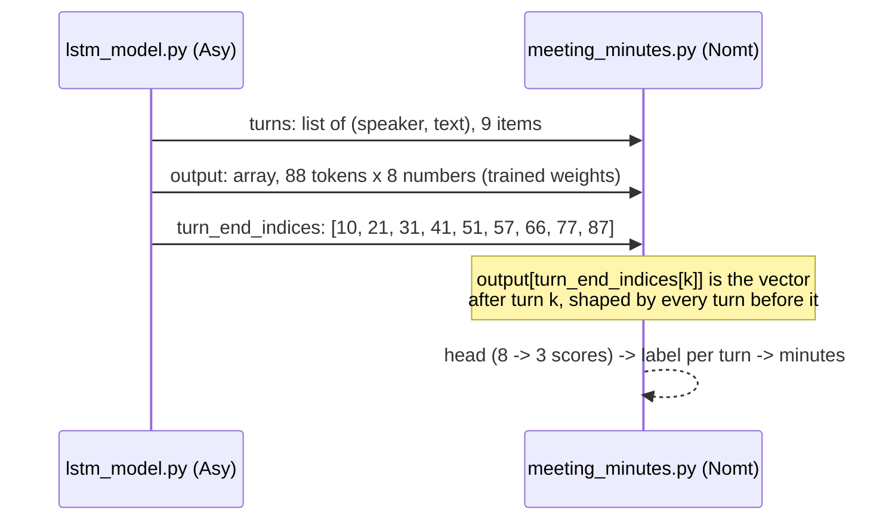

# Progress: Asy (LSTM track)

| | |
|---|---|
| **Owner** | Asy |
| **Track** | 2: LSTM (with Nomt, who owns meeting minutes) |
| **Code** | `prototype/lstm_model.py`, `prototype/train_lstm.py`, `prototype/training_data.py`, `prototype/holdout_data.py`, `prototype/transcript_placeholder.py`, `prototype/hands_on.py`, `prototype/scorecard.py`, `prototype/compare_rnn.py` |
| **Last updated** | 17 Oct 2026 |
| **Current phase** | Testing, 5 days before the workshop (Thu 22 Oct, 7-9 PM, TR+102 NTU). The 13 Oct ensemble plus the 16 Oct text clean-up is shipped. Real-microphone audio is the open risk: `medium.en` is at 89% of words on Asy's recording (bar 90%). Next: a team member's recording, a dry run of the notebook on Colab, real meetings |

Current results and how the pipeline works are in the [README](README.md); test results are in [testing/testing.md](testing/testing.md). This file is the history: what was done, decided and is next.

Update this file whenever something is finished, decided or blocked. Tick the box, add a line to the [log](#log), and move the node in the [roadmap](#roadmap).

---

## At a glance

| Area | Status | Note |
|---|---|---|
| Placeholder transcript | Done | Same contract the real transcriber will use |
| LSTM forward pass | Done | Continuous across all turns |
| Hourglass architecture | Done | 8 / 16 / 32 / 16 / 8, adapted from Li et al. (2024) |
| What the LSTM should learn | Done | Per-turn classifier: action_item / decision / discussion (see [decisions](#decisions)) |
| Labelling guide + rule | Done | Rule locked 7 Oct, clarified 8 Oct; blind cross-check: Nomt 10/10, Asy pending |
| Training data | Done (draft) | 40 hand-labelled meetings (577 turns: train 464, dev 68, test 45) + 60 generated practice meetings + a frozen 6-meeting scorecard (105 turns) + 17 holdout meetings (271 turns, 16 Oct); Nomt checked his half 8 Oct (no label changes); the 13 Oct additions are not yet checked by a person |
| Training | Done | Shipped: the tuned 13 Oct ensemble with the 16 Oct text clean-up in front. Numbers in the [README](README.md#current-results); the retrains that were rolled back or not shipped (8 Oct, first 13 Oct, two on 16 Oct) are in the [log](#log) |
| Participants' hands-on | Done | `hands_on.py`: Part A the RNN step (+ memory off), Part B the LSTM notebook update (+ forget knob); `pipeline.py --text` for their own lines |
| RNN vs LSTM check | Done | `compare_rnn.py`: no clear difference, with both the old and the tuned settings (rule written beforehand) |
| Hand-off to Nomt | Done | `run_pipeline()` loads the trained weights; `label_turns_model()` in `meeting_minutes.py` |
| Real transcriber swap | In progress | English-only `medium.en`, word-level pauses. Passes on clean synthetic speech; on Asy's real microphone recording: 9 of 9 turns, 89% of words (bar 90%). **Done when** a team member's recording gives `transcriber: PASS` (`python testing/solo_test.py --name YOU`; `WHISPER_MODEL=small.en` for a faster, less accurate run) |
| Participants' notebook | Done, not yet run on Colab | `notebook/audio_workshop.ipynb` (five sections like the poster) + `notebook/make_bundle.py`; every cell ran from a fresh folder on a laptop CPU |
| Debug cheat sheet | Done | [debug_cheatsheet.md](debug_cheatsheet.md), from the failures hit while testing |

---

## Roadmap

Green: done · Blue: in progress · Dashed: to do

---

## Checklist

### Weekend 1: build the pieces

- [x] Create private repo `mlda-audio-workshop`, add Nomt as collaborator (25 Sep)
- [x] Placeholder transcript with the `get_transcript(audio_path=None) -> str` contract (25 Sep)
- [x] First NumPy LSTM forward pass, one line at a time (25 Sep)
- [x] Run the LSTM continuously across turns, with `<eot>` markers between speakers (25 Sep)
- [x] Restructure into a 5-layer hourglass LSTM, adapted from Li et al. (2024) (26 Sep)
- [x] Interactive explainers: *Minutes Pipeline* and *Inside the LSTM Cell* (26 Sep)
- [x] README, this tracker, and first push to GitHub (26 Sep)
- [x] Decide what the LSTM should learn (with Nomt): per-turn classifier, action_item / decision / discussion (27 Sep)

### Weekend 2: connect

- [x] Wrap `main` in an importable `run_pipeline()` for the minutes step (27 Sep)
- [x] Scaffold `train_classifier.py`: PyTorch, one hand-labelled meeting, loop runs + times an epoch (27 Sep)
- [x] Lock the action-item rule in the labelling guide: label the request **and** the reply (7 Oct)
- [x] Training data: 11 hand-labelled meetings across group project, lab stand-up, CCA committee, club event, hackathon (211 turns), plus 12 probes and a practice-meeting generator (7 Oct, first draft)
- [x] Train the hourglass + classifier head on it: `train_lstm.py`, NumPy, weights load straight into `lstm_model.py`, no port needed (7 Oct)
- [ ] Blind check: Asy and Nomt each label 10 of the other's turns; tighten the guide where they disagree, then rerun `train_lstm.py` (sheets prepared 8 Oct; Nomt's 10: 10/10 agree; Asy's 10 pending)
- [ ] Swap the placeholder for Track 1's real transcriber and run the full chain once: wired up 7 Oct (`pipeline.py`), works on synthetic and LibriSpeech audio (see log); tick this when a team member's recording gives `transcriber: PASS`

### Weekend 3: freeze

- [x] Decide which 20% participants complete: write the RNN step, then the LSTM notebook update and the forget knob, then personalise with their own lines (agenda agreed 13 Oct)
- [x] Write participant starter code and a debug-time cheat sheet: `hands_on.py`, `pipeline.py --text` (13 Oct), the Colab notebook and [debug_cheatsheet.md](debug_cheatsheet.md) (17 Oct)
- [ ] Dry run with someone outside the LSTM track, on a fresh Colab runtime, then freeze (needs a person; the notebook has only been run on a laptop)

---

## Log

### Fri 25 Sep 2026

- Created private repo `Asyxddiq/mlda-audio-workshop`; Nomt added as collaborator.
- Built `transcript_placeholder.py`: a 9-turn sample meeting behind `get_transcript()`, so the LSTM track isn't blocked on the transcriber.
- Built LSTM v1 in plain NumPy (PyTorch wasn't installable in the build sandbox, and NumPy keeps the gates visible for teaching).
- Changed to one continuous pass over the whole conversation. Long-range memory across turns is the reason to teach LSTM at all, and v1 reset state at every line.

### Sat 26 Sep 2026

- Checked the "deep research" summary against the actual paper PDF: the summary described a different CNN + LSTM sound-classification model. Worked from the actual paper instead.
- Adapted the paper's hourglass: 5 layers (8 / 16 / 32 / 16 / 8 units over 88 / 44 / 22 / 44 / 88 steps), lossless fold and unfold, skips 1→5 and 2→4, no attention gates.
- Noted two things in the code: the paper's "1014 units" is almost certainly a typo for 1024, and folding lets a word see up to 3 words ahead (fine for minutes).
- Built two interactive explainers using the real numbers from the run.
- Wrote README and this tracker; pushed prototype to GitHub.
- Observation: with random weights every forget gate sits near 0.49, so almost nothing survives 47 words in layer 1. Training is what would fix this. It's a good example for the workshop.

### Sun 27 Sep 2026

- Settled the core plan with Asy (see [decisions](#decisions)): train the hourglass **itself** as a per-turn classifier (action_item / decision / discussion), keyword rules first as baseline + fallback, PyTorch on Colab for training with NumPy kept for the teaching forward pass.
- Added `run_pipeline()` to `lstm_model.py` (importable hand-off) and a first `meeting_minutes.py` (Markdown minutes: Decisions + Action Items) that runs on a hand-labelled stub.
- Scaffolded `train_classifier.py`: mirrors the 4-gate cell in PyTorch (not `nn.LSTM`), trainable embeddings with a fixed vocab + `<unk>`, float64 for weight-port parity. Runs on one hand-labelled meeting to prove the loop and time an epoch. Colab-only (PyTorch isn't installable in the build sandbox).
- Two calls still **proposed, pending Asy**: the action-item labelling rule (request / acceptance / both — we lean toward *both, merged in rendering*), and a curated cross-turn *probe set* for the held-out comparison. Detail lives in the new labelling guide.
- Note: the scaffold's `GOLD_LABELS` and `meeting_minutes.py`'s stub still use request-only labelling; both need updating together once the action-item rule is locked.

### Wed 7 Oct 2026

- Pasan pushed `transcriber.py` (Whisper, with pause-based speaker labels and a placeholder fallback) and `rnn_ctc_demo.py` (NumPy RNN + CTC teaching demo).
- Connected the three stages. `run_pipeline()` now takes an audio path or a ready transcript and reads from `transcriber.py`. `meeting_minutes.py` gained `label_turns_keywords()`, which labels any transcript and is now the default; on the sample meeting it gives exactly the stub's labels. New `pipeline.py` runs transcriber → LSTM → minutes in one command.
- Known gaps: the pause rule merges quick replies ("Sure.", "Agreed.") into the previous speaker's turn, which hides the cross-turn cases the labelling guide relies on. The Whisper path still needs one run on real audio.
- **Trained the model.** Locked the action-item rule (request **and** reply) and the probe set. Wrote the first full dataset in `training_data.py`: 11 hand-labelled meetings (211 turns: train 7, dev 1, test 3 including the sample meeting) and 12 probes. A first training run memorised the 146 training turns within ~10 epochs, so added a generator of short practice meetings (training only).
- `train_lstm.py` trains embeddings + all 5 hourglass layers + a small head with hand-written NumPy backprop, checked against numerical gradients. Settings were picked on the dev meeting only; 5 seeds, keep the lowest dev loss.
- A separate review of the data found generator phrases too close to the sample meeting and some probes, one inconsistent rule (chair's "Let's X"), and some minutes-rendering bugs. All fixed, then retrained. A 5-word leak check now runs in `training_data.py`.
- Result (test, 45 turns): accuracy 0.84 / macro-F1 0.82, against keyword rules 0.69 / 0.59; probes 9/12 against 3/12. Seeds range 0.69–0.84. Weakest spot: decisions reported as facts ("Venue is confirmed"), 4 of 10 missed; on the sample meeting it finds the action item but neither decision.
- Minutes now merge a request and its reply into one action item (owner = the person who accepted) and show what an "Agreed." agreed to.

### Thu 8 Oct 2026

- Nomt checked his half (4 meetings, 84 turns) with Claude's help. Three borderline turns were kept as labelled, because changing them would contradict how the same kind of turn is labelled elsewhere in the data. The three rules behind them (echoed replies, ownerless "let's", finished tasks vs settled plans) are now written into the labelling guide. No labels changed, so no retrain and `trained_lstm.npz` is unchanged.
- Fixed a minutes bug found during the check: `_decision_text()` could pin an agreement on a proposal the group had rejected (an echoed objection like "Same, people really like the medals." was shown as agreeing to "Just give certificates to those runners"). It now stops looking back at an objection or new point. Checked old vs new minutes on all 11 hand-labelled meetings and 60 generated ones: no differences, and the targeted case is fixed. All scripts in `prototype/` still run, and the sample meeting's minutes in `pipeline.py` are unchanged.
- Blind-check sheets prepared outside the repo (10 of Asy's turns for Nomt, 10 of Nomt's for Asy, keys kept separate); still to be labelled.
- Nomt blind-labelled 10 of Asy's turns: 10/10 agree with the labels, so no label changes and no retrain. One turn (a conditional offer, "I can redo the template tonight if nobody minds.") wasn't covered by the guide; the rule is now written in. Asy's 10 still to do.
- First audio run, on **synthetic speech** (Windows text-to-speech, two voices; files kept outside the repo): installed `openai-whisper` and ffmpeg and ran `pipeline.py` on three recordings. The sample meeting came back as 8 turns instead of 9, with one word wrong ("Veneu"): Whisper gave "Can you follow up with catering by Friday?" and "Yes, I'll email them today." back-to-back segments, so the pause rule merged the reply into the request, every later speaker label flipped, and the action item's owner came out as Speaker1. Both quick-reply files (request → "Sure.", proposal → "Sounds good.", update → "Okay.") came out as one single turn, including the control with longer gaps, because Whisper's segment timestamps run end to start even where the audio has 1.3–2.1 s of silence, so the 0.8 s rule never fires (the "quick" 0.4 s gap also came out near 1.3 s, as switching voice adds its own pause). With the turns separated correctly (text path) the trained model labels the three replies right (`action_item`, `decision`, `discussion`); keyword rules get one of three.
- New `pipeline.py --compare` view: keyword-rule label and trained-LSTM label side by side for every turn, with a `*` where they differ. On the sample meeting 3 of 9 turns differ: the two decisions ("Venue is confirmed...", "Noted, let's add that...") are `decision` for keywords but `discussion` for the LSTM, and "Yes, I'll email them today." is `discussion` for keywords but `action_item` for the LSTM.
- Fixed the turn splitting with one change in `transcriber.py`: Whisper now runs with `word_timestamps=True`, so segment times follow the speech and the 0.8 s pause rule fires. Re-ran the three recordings: the sample meeting is now 9 of 9 turns with alternating speakers, and the action item's owner is Speaker2 (the person who accepted); both reply files are 6 of 6 turns, and the trained LSTM labels all three replies right (`action_item`, `decision`, `discussion`) where keyword rules get one of three. One small artefact: the sample's turn 5 picked up a repeated word ("...by Friday? Friday."). The change is in Pasan's file, made with Nomt's approval, and flagged to Pasan to review.
- **More decision examples, retrained.** The rule for "better" was written down before retraining and judged on dev only: the new model must label the dev meeting's reported-fact decision ("The security office confirmed two officers for the morning.") as a decision, and keep dev accuracy at 0.95 or more and macro-F1 at 0.88 or more. Changes are in the training split only: one new hand-written training meeting (`orientation_1`, 19 turns) and new generator patterns for settled plans and reported confirmations (decision), finished tasks and status updates (discussion), and "Noted, ..." replies. Dev, test and probes are untouched; the 5-word leak check passes, and a new check confirms no dev sentence shares 5 words in a row with the training data.
- Result: the rule passed (dev 1.00 / 1.00), but held-out scores went down. Test (45 turns): accuracy 0.76 / macro-F1 0.74, was 0.84 / 0.82. The two test meetings nobody looked at: 0.78 / 0.77, was 0.86 / 0.85. Probes 9/12, unchanged. Sample meeting 6/9 turns, was 7/9. Seeds are steadier: test accuracy 0.76 to 0.82 (mean 0.79, macro-F1 mean 0.77), was 0.69 to 0.84 (mean 0.75, macro-F1 mean 0.69). Still 4 of the 10 test decisions missed, and 5 discussion turns are now called decisions.
- Why the rule passed without a held-out gain: one new generator pattern ("{org} confirmed {thing} for {when}") has the same shape as the dev sentence, so dev saturated (the chosen seed scores 1.00 there) and can no longer tell models apart. A one-turn rule on a 20-turn dev meeting was too thin.
- Asy decided to ship the retrained model. On the sample meeting the minutes changed: "Good, let's keep monitoring that." is now listed as a decision, "Noted, let's add that to the next agenda." as an action item, and "Venue is confirmed for the 14th" is still missed. The previous weights are in git history if we roll back.
- New `pipeline.py --meeting NAME` runs any hand-labelled meeting from `training_data.py` through the LSTM and minutes, and `--compare` gains a hand-label column. Unknown options now give an error instead of being read as an audio path. For choosing the demo meeting, turns matching the hand labels (LSTM vs keyword rules): group_project_3 15/18 vs 12/18, hackathon_1 13/18 vs 11/18, sample meeting 6/9 vs 8/9 (first version: 16/18, 15/18, 7/9).

### Sun 11 Oct 2026

- **Rolled back `trained_lstm.npz` to the 7 Oct weights** (Nomt; for Asy to confirm in review). The 8 Oct model was worse on every held-out measure: test 0.76 / 0.74 vs 0.84 / 0.82, the two untouched meetings 0.78 / 0.77 vs 0.86 / 0.85, the sample meeting 6/9 vs 7/9, probes 9/12 for both. On the demo meeting its minutes listed two wrong items ("Good, let's keep monitoring that." as a decision, "Noted, let's add that..." as an action item); the 7 Oct model lists the action item and no wrong ones. The pass on the improvement rule doesn't count for much once dev saturated, since dev could no longer separate the models.
- Re-scored the restored weights against the current code and data: test 0.84 / 0.82, untouched meetings 0.86 / 0.85, sample 7/9, probes 9/12, matching the 7 Oct numbers. The 7 Oct vocabulary (392 words) is stored in the weights file, so the newer `training_data.py` doesn't affect it.
- Kept everything else from 8 Oct: the decision-as-fact training examples, the dev-vs-train leak check, and `pipeline.py --meeting`. With the restored weights, `--meeting group_project_3` matches 16/18 hand labels against 12/18 for keyword rules, which makes it a strong candidate for the live demo.

### Tue 13 Oct 2026

- **Rebuilt from Nomt's 11 Oct state (e052a01).** An earlier session's 13 Oct work was lost before it was pushed (its workspace was reset), so everything below was rebuilt and retrained from scratch; the figures shared in chat from that lost session don't apply.
- New `pipeline.py --text FILE`: run your own lines ("Speaker: text", optionally with `act` / `dec` / `dis` in front of every line for a hand-label column), and see which words the model never saw. Example: `prototype/my_meeting_example.txt` (7 lines; the 7 Oct model gets 7/7, keyword rules 5/7).
- New `hands_on.py` for the participants' 20% (with `hands_on_reference.py` and `--solution`). Part A: write `h = tanh(W_x·x + W_h·h_prev + b)`; two 12-word sentences that differ only in the first word show the memory gap fading by about 58% per step, and with `MEMORY_ON = False` the gap is 0 from word 2. Part B: write `c = f·c_prev + i·g`, which then runs inside the trained model; with `FORGET_KNOB = -6` the notebook loses the first word at once, with `+6` it still holds it at word 12, and the 7 Oct model's test score goes from 38/45 at 0 to 9/45 at −6 and 25/45 at +6. Both knob extremes hurt the trained model, so block 8 should say that, not "keep a lot = better memory".
- Ensemble support: `trained_lstm.npz` can hold several models (`m0_`, `m1_`... keys), `lstm_model.label_probabilities()` averages them, and `label_turns_model()` uses it. Old single-model files load as before, so the shipped 7 Oct file is unchanged.
- **Scorecard written first and frozen.** Six new meetings (105 turns: hall council, tutoring, band, research group, football, charity drive) were written before any new training data or training, then hash-locked (`scorecard.py` refuses to run if `scorecard_data.py` changes) and only scored once, after the ship decision. Three of its lines were reworded before that first score because the leak check found 5-word overlaps with older training lines. Caveat: Claude wrote them after seeing the earlier model's weak spots.
- **More data:** 24 training meetings (299 turns) and 4 dev meetings (dev is now 5 meetings, 68 turns, so it no longer saturates). The leak check now covers the scorecard as well; one new dev line was reworded to pass it.
- **Ship rule, written before training:** dev accuracy and macro-F1 both +0.03 or more against the 7 Oct model, no held-out measure lower (test, the two untouched test meetings, probes, sample), plus the 11 Oct team rule (test macro-F1 at least 0.82, no wrong items in the demo minutes). Fixed settings, no sweeps: 5 seeds kept as an ensemble, `<unk>` dropout 0.15.

| KPI | Shipped (7 Oct) | 13 Oct ensemble | Keyword rules | Rule |
|---|---|---|---|---|
| Dev accuracy / macro-F1 (68 turns) | 0.90 / 0.87 | **0.94 / 0.92** | | pass |
| Test accuracy / macro-F1 (45 turns) | 0.84 / 0.82 | 0.84 / 0.83 | 0.69 / 0.59 | pass (equal) |
| Two untouched test meetings, accuracy (36 turns) | **0.86** | 0.83 | 0.64 | **fail** |
| Probes (of 12) | **9** | 8 | 3 | **fail** |
| Sample meeting (of 9) | 7 | **8** | 8 | pass |
| Scorecard accuracy / macro-F1 (105 turns, after the decision) | 0.78 / 0.72 | **0.84 / 0.79** | 0.76 / 0.61 | not in the rule |

- **Result: not shipped.** Better on dev and the scorecard, but lower on the untouched test meetings and the probes, so `trained_lstm.npz` keeps the 7 Oct weights. Same pattern as 8 Oct: our own extra writing lifts dev more than the meetings nobody tuned on. Single seeds: test accuracy 0.78 to 0.87.
- **Flagged failures (13 Oct ensemble):** decisions stated as facts ("Venue is confirmed for the 14th", "We have three sponsors confirmed so far"); the chair settling a plan ("Okay, Thursday at four then."); 3 of 4 agreement probes called discussion; missed requests ("Could you order for seventy instead of sixty this time?", "I'll let the venue team know."); false action items ("Can you remind me where the form is?", "I won't be able to come on the second day"); on the scorecard decision precision is 0.57 (too many turns called decisions). Its demo minutes have no wrong items.
- **RNN vs LSTM** (`compare_rnn.py`, for Pasan and Rahini): same hourglass with plain RNN layers, both trained on the same data with the same 5 seeds. Rule written before the run: "LSTM better" needs +1 probe and +0.05 macro-F1 on 5-seed means. Test means: LSTM 0.82 / 0.80, probes 7.6; RNN 0.80 / 0.76, probes 9.0. Verdict: **no clear difference** (+0.046 macro-F1 for the LSTM, but 1.4 fewer probes). Memory reach (how much blanking the turn d back moves the current prediction): LSTM 0.074 / 0.011 / 0.004 / 0.001 for 1 to 4 turns back, RNN 0.077 / 0.020 / 0.006 / 0.000. Both use about one turn of context, which is all this task needs.

### Tue 13 Oct 2026 (evening): tuning

- Asy asked to train as many times as needed for the best score before the testing phase. The rule, written before any tuning run: choose settings on **dev only** (68 turns), rank by ensemble dev log-loss with macro-F1 as tie-break, then score the held-out sets **once** and apply the same ship rule as before.
- Stage 1, one change at a time from the 13 Oct settings, 3 seeds each (ensemble dev log-loss; lower is better): baseline 0.216; learning rate 0.01: 0.196; 32-number embeddings: 0.196; 16 units: 0.215; `<unk>` dropout 0.05: 0.222; 150 generated meetings: 0.220; `<unk>` dropout 0.30: 0.259; weight decay 0.001: 0.259; 12 units: 0.269; keep words seen once: 0.279; no generated meetings: 0.292; learning rate 0.003 for 60 epochs: 0.304.
- Stage 2, 5 seeds: learning rate 0.01 + 32-number embeddings: 0.175 (dev accuracy 0.96, macro-F1 0.95); adding 16 units: 0.187 (macro-F1 0.91). Five more seeds of the winner, or keeping the best seeds by dev loss, gave the same dev accuracy and macro-F1, so the plain 5 seeds (0 to 4) were kept, the best one by dev loss first in the file.
- One look at the held-out sets, against the 7 Oct model: test 0.84 / 0.825 (0.84 / 0.82), the two untouched test meetings 0.86 (0.86), probes 9/12 (9/12), sample 7/9 with no wrong items in the minutes (same), dev 0.96 / 0.95 (0.90 / 0.87). **The ship rule passes**, so the tuned ensemble is the new `trained_lstm.npz`. Scorecard, scored once after that: 0.90 / 0.87 (7 Oct 0.78 / 0.72, keyword rules 0.76 / 0.61); decision precision 0.71, recall 0.88.
- The new defaults in `train_lstm.py` (learning rate 0.01, 32-number embeddings) reproduce the tuned seeds exactly: seed 4's dev loss came out at 0.192775 in both runs.
- **Flagged failures (shipped model):** decisions stated as facts ("Venue is confirmed for the 14th", "We have three sponsors confirmed so far", "Noted, let's add that to the next agenda."); the chair settling a plan ("Okay, Thursday at four then."); 3 of 4 agreement probes called discussion; a missed request ("Could you order for seventy instead of sixty this time?"); false action items ("Can you remind me where the form is?", "I won't be able to come on the second day").
- `hands_on.py` Part B with the shipped model (member 0, the best seed by dev loss): 35/45 test turns right at `FORGET_KNOB = 0`, 10/45 at −6, 22/45 at +6. Both extremes still hurt.
- RNN vs LSTM rerun with the tuned settings: LSTM 0.80 / 0.77, probes 7.8; RNN 0.80 / 0.78, probes 8.0 (5-seed means, single models). Still **no clear difference**. Memory reach: LSTM 0.053 / 0.006 / 0.002 / 0.001, RNN 0.075 / 0.013 / 0.004 / 0.000.

### Wed 14 Oct 2026

- Added `prototype/run_tests.py`: one command (`python prototype/run_tests.py`, about 25 s, standard library + numpy, no training, no internet) that checks the imports; the shipped weights (5-model ensemble, labels); that the shipped numbers reproduce (dev 0.96 / 0.948, test 0.84 / 0.825, the 36 other test turns 0.86 / 0.853, sample meeting 7/9, probes 9/12); the demo minutes (no wrong items); the `--text` example (7/7); `hands_on.py` with and without `--solution`; the training-data leak checks; the scorecard; smoke runs of the other scripts; and that the run leaves the repo unchanged. `--audio FILE` adds a pipeline run on a recording when Whisper and ffmpeg are installed. It does not run `train_lstm.py` or `compare_rnn.py`. With the 7 Oct weights swapped in, the weights, KPI and hands-on checks fail with a hint to restore the shipped file.
- Fixed `scorecard.py` refusing to run on Windows checkouts: git's default line-ending conversion gave `scorecard_data.py` CRLF endings, which changed its hash although the file was unchanged. The hash now ignores line endings; the frozen value is the same.

### Thu 15 Oct 2026

- Meeting tests (pushed 14 Oct, e30953a): `prototype/minutes_tests.py` runs 67 typed meeting cases (actions, decisions, discussion-only traps, the same short reply after different lines, whole meetings), listed with their expected minutes in `testing/testing script.md`. Trained model 45/67, keyword fallback 28/67; every remaining failure is a label from the model (mostly missed decisions), none is in the minutes code. Test only, never for training or tuning. Same commit: three owner/due-date fixes in `meeting_minutes.py` (a named person who isn't in the meeting; a request turned down goes to "unassigned" or to whoever then says "I'll do it."; "before the next meeting" as a due date), for Nomt to review.
- Solo audio tests, so one person can do the human-recording check: `audio_tests/solo_1_sample_meeting.txt` (the sample meeting) and `solo_2_bake_sale.txt`. One person reads every line, stopping 2 s between lines, so the 0.8 s pause rule alternates the speakers.
- `audio_check.py` now gives two verdicts: **transcriber** (turns, speaker pattern, at least 90% of words) and **end to end** (also the same labels and minutes). Minutes items match when owners and due dates are the same and the words are at least 80% the same.
- Checked on Claude's side with the same Whisper **base** weights run through ONNX (openai-whisper can't be installed there) and synthetic voices; setup and every run are in [testing/testing.md](testing/testing.md#claudes-side). Real human speech (LibriSpeech) and a clear one-voice `solo_1` pass; 0.4 s gaps and rough voices fail, as they should. On `solo_2` the words came through but the labeller reacted to small wording changes ("I will bring" for "I'll bring").
- Status: the "Real transcriber swap" row stays **In progress** until a recording of a real team member passes.

### Fri 16 Oct 2026

- **Testing phase** set up in `testing/` ([testing.md](testing/testing.md)): `solo_test.py` records one person line by line (or checks a phone recording) and saves the result; the reading scripts are copied to `testing/scripts/`. Claude's side: repo check 13/13, meeting tests 45/67, clean-up tests 31/31, audio as above. Manual runs: none yet.
- **Model update** ([write-up](testing/model_update_16oct/model_update.md), [rule written before training](testing/model_update_16oct/ship_rule.md)). Asked for: a text clean-up and more decision examples.
  - Shipped: `normalise()` in `lstm_model.py`, which reads "I will" as "I'll", "let us" as "let's", "OK" as "okay" and drops fillers, in front of the unchanged 13 Oct weights. It changes no dev or test turn, so every earlier number is the same; holdout 1 goes from 125 to 131 of 149 turns, and the `solo_2` "I will bring" run now passes end to end.
  - Not shipped: two retrains with new decision data. Round 2 passed 50 of the 67 meeting tests (was 45) but fell on the team's test meetings (34 of 45, was 38) and listed a wrong decision in the demo minutes. `round2.patch` reproduces them.
  - New held-out data: `holdout_data.py`, 17 meetings in two sets; the second was written after round 1 failed so round 2 could be judged on unseen meetings. The leak check now covers the holdouts and the meeting tests.
  - Takeaway: more of our own writing moves our own tests and hurts the team's; decisions need real meetings.

### Sat 17 Oct 2026

- **Asy's first real-microphone runs** (testing phase, [results](testing/testing.md#manual-runs-by-the-team)). They failed, and showed four things:
  - Whisper guessed the language from the accent (Malay), which also made it take minutes. Fixed: English only (`.en` models, `language="en"`, `task="transcribe"`).
  - Whisper joined several spoken lines into one segment, so the 0.8 s pause rule saw 3 turns instead of 9. Fixed: the rule runs on single words. For one person reading with 2 s gaps the solo test uses a 1.5 s gap (pauses inside a line were at most 1.1 s, gaps between lines at least 2.3 s); pair tests keep 0.8 s. `get_transcript(audio, pause_gap=...)`.
  - Accent and a noisy room: `small.en` heard 60-72% of the words. Compared on the real recordings: `medium.en` 85-90%, `turbo` 76-90%, `small.en` 72-80%. `medium.en` through the real pipeline: 9 of 9 turns, 89% of words, one point under the bar. It is now the transcriber default (slow on a CPU; `WHISPER_MODEL` switches size).
  - A 23 s near-silent recording came back as the single word "Classroom": Whisper invents text from silence.
- **Testing tools** (all in `testing/`): `try_it.py` (talk like a meeting; your own audio goes through Whisper, features + RNN + CTC, the LSTM and the minutes, PASS or FAIL for each), `phases.py` (each phase on its own, automatic or `--manual`), a 50-line reading script `solo_3`. `phases.py` bug found by Asy's run and fixed: letters typed without spaces were rejected.
- **Participants' notebook** `notebook/audio_workshop.ipynb`, five sections matching the poster (audio to text, where transcription struggles with noise, a poor microphone and your own accent, RNN with the YOUR TURN `rnn_step`, LSTM with the YOUR TURN notebook update and forget knob, meeting minutes), built on `hands_on.py`. `notebook/make_bundle.py` makes the one zip to upload to Colab (the repo is private). The audio is `audio_features.py` (13 numbers per 10 ms) feeding the RNN. Every cell ran from a fresh folder holding only the zip.
- **Demo meetings chosen**: live audio = the sample meeting (the only unseen meeting with exactly two speakers, which is all the audio pipeline can separate; no wrong items, finds the action item, misses both decisions). Typed, the model at its best = `student_council` (`prototype/demo_student_council.txt`; holdout, never trained on; 17 of 18 turns, no wrong items; keyword rules miss every decision). `group_project_3` was dropped: its minutes list a wrong action item ("Remind me where the form is"), against the team rule.
- **Debug cheat sheet** written: [debug_cheatsheet.md](debug_cheatsheet.md).
- Still needs a person: a team member's recording at 90%+, a dry run on Colab itself, Asy's blind check.

<!-- Add new entries above this line, newest date last. -->

---

## Decisions

| Date | Decision | Why |
|---|---|---|
| 25 Sep | Plain NumPy, no ML framework | Gates stay visible as maths; runs on free Colab with nothing to install |
| 25 Sep | One continuous sequence, never reset between turns | Long-range memory across turns is the concept being taught |
| 25 Sep | Insert `<eot>` between turns | Gives the model a signal that the speaker changed |
| 26 Sep | Hourglass layout from Li et al. (2024), simplified | Real, citable architecture; shorter path for memory in the neck |
| 26 Sep | Skips add; no attention gates | Easier for beginners; attention can be a stretch topic |
| 26 Sep | `meeting_minutes.py` kept out of the repo | Nomt owns the minutes step; avoid giving him a conflicting starting point |
| 27 Sep | Train the hourglass **itself** as a per-turn classifier (action_item / decision / discussion), not a separate LSTM | A separate LSTM would leave the hourglass as decoration; the architecture we teach should be the one that does the work |
| 27 Sep | Keyword rules shipped first, as baseline **and** runtime fallback | Unblocks the pipeline now; doubles as the "where rules break" teaching contrast |
| 27 Sep | Train in PyTorch on Colab; NumPy hourglass stays forward-pass-only for teaching. Mirror the 4-gate cell (not `nn.LSTM`); float64 for weight-port parity | Autograd handles training; `nn.LSTM`'s packed gates make porting fiddly; NumPy stays readable. **Revised 7 Oct**, see below |
| 27 Sep | Trainable embeddings, with a **fixed** training vocab + `<unk>` token | Teaches that embeddings are learned too; `<unk>` stops unseen words (held-out / *Try and test*) crashing. Not framed as "learns meaning" — too little data for that |
| 27 Sep | Seed ~15–20% of training turns with cross-turn-dependent labels (e.g. "Sure." after a request) | Gives the hourglass an honest reason to exist; keyword rules provably can't catch these |
| 27 Sep | ~100 hand-labelled turns across meeting types, 50/50 — Nomt: CCA committee + club event; Asy: group project + lab stand-up. Split train/held-out **by meeting** | Variety covers participants' likely contexts; splitting individual turns leaks vocab/state and inflates held-out scores |
| 27 Sep | Evaluate with per-label / confusion matrix; beat **both** the majority-class and keyword baselines | Most turns are "discussion", so plain accuracy flatters the model |
| 27 Sep | The graded 20% is done on **one shared meeting**; participants' own context lives only in *Try and test*, with keyword rules as the fallback there | 30 people each training/debugging their own data in one session would break debug time |
| 27 Sep | Minutes format: Markdown — Decisions + Action Items | Matches the repo's Markdown-first docs; short and demo-friendly |
| 7 Oct | **Locked:** label action items on **both** the request and the acceptance; merge the pair in the minutes (task + deadline from the request, owner from the acceptor) | Task and owner live in different turns; also creates the keyword-free acceptance turns that need memory. See the [labelling guide](labelling_guide.md) |
| 7 Oct | **Locked:** a held-out cross-turn **probe set**: 12 two-turn exchanges, the same bare replies under all three labels | The "hourglass earns its keep" claim is too small/noisy to rest on aggregate held-out accuracy |
| 7 Oct | Train in **NumPy** (`train_lstm.py`), with hand-written backprop checked against numerical gradients. The PyTorch scaffold stays as a reference | Same weight shapes as `lstm_model.py`, so no port step; numpy is the only dependency; PyTorch couldn't be installed where the training was run |
| 7 Oct | Add generated practice meetings to the **training** split only; dev, test and probes stay hand-written | 146 hand-written training turns were memorised in ~10 epochs; the generator adds many more cross-turn examples |
| 7 Oct | A chair's "Let's X" that settles a choice is a `decision`; procedural "let's" stays `discussion`. Reported confirmations ("Venue is confirmed") are `decision` | Makes the labels consistent across meetings (the review found both labels in use) |
| 7 Oct | Model selection on the dev meeting only (5 seeds, lowest dev loss); every seed's test score is printed | With this little data the seed matters; printing all of them stops a lucky seed hiding the spread |
| 7 Oct | Commit the trained weights (`trained_lstm.npz`, float16, 49 KB) | `pipeline.py` uses the trained model straight after cloning; float16 gives identical labels at half the size |
| 8 Oct | Keep the 3 borderline labels in Nomt's half; write the rules into the guide instead | Each change would contradict how the same kind of turn is labelled elsewhere; the rules were implicit, which likely feeds the model's weakness on decisions reported as facts |
| 8 Oct | Ship the retrained model (more decision-as-fact examples) although held-out scores dropped | It passed the improvement rule written before retraining (judged on dev), and seeds are steadier (0.76 to 0.82 vs 0.69 to 0.84). Asy's call; the first version is in git history. **Reversed 11 Oct**, see below |
| 11 Oct | Roll back to the 7 Oct weights; keep the 8 Oct data, checks and `--meeting` | Worse on every held-out measure and wrong items in the demo minutes; the dev rule it passed can't separate models once dev saturates. Nomt's call, for Asy to confirm in review |
| 13 Oct | Participants' 20%: write the RNN step (Part A) and the LSTM notebook update plus forget knob (Part B) in `hands_on.py`; personalise with their own lines through `pipeline.py --text` | Matches the agreed agenda; one line of maths each with an instant check; their own lines need no retraining |
| 13 Oct | A frozen scorecard: 6 meetings written before training, hash-checked, aggregate scores only | Dev saturated on 8 Oct; this is a second held-out look that can't be tuned against turn by turn |
| 13 Oct | Bigger dev set (5 meetings, 68 turns) | The 8 Oct lesson: one 20-turn dev meeting couldn't tell models apart |
| 13 Oct | Ensemble support in the code; default `ENSEMBLE = True` for new training runs | Steadier than one seed; old single-model weight files still load |
| 13 Oct | Keep the 7 Oct weights; don't ship the first 13 Oct ensemble | Failed the do-no-harm check written beforehand (untouched test 0.83 vs 0.86, probes 8 vs 9), although better on dev and the scorecard. **Superseded the same evening** by the tuned ensemble, below |
| 13 Oct | Tune settings on dev only (12 single changes, then the best combination); ship the tuned 5-seed ensemble | Asy asked for the best score before testing. Held-out sets were scored once, after the choice, and the same ship rule passed: nothing below the 7 Oct model, dev 0.96, scorecard 0.90 |
| 13 Oct | RNN vs LSTM: "no clear difference" | Rule written before the run; both models use about one turn of context |
| 17 Oct | Whisper: English-only `medium.en` as the default, word-level pauses, `pause_gap` 1.5 s for the solo test | Real accented microphone audio: `small.en` gave 60-72% of the words and merged turns; `medium.en` gives 9/9 turns and 89%. Language guessing turned an accent into Malay |
| 17 Oct | Live audio demo = the sample meeting; typed demo = `student_council`; drop `group_project_3` | Only the sample meeting has two speakers; `student_council` is unseen and has no wrong items; `group_project_3` lists a wrong action item |
| 17 Oct | Hand the notebook out as one `.ipynb` plus one zip (`make_bundle.py`) | The repo is private, so Colab cannot clone it |
| 16 Oct | Ship the text clean-up on the 13 Oct weights; don't ship either retrain | The retrains failed the rule written before training (test meetings and demo minutes got worse); the clean-up changes no measured turn and fixes "I will" style transcripts |

---

## Open questions

- [x] **What should the LSTM predict?** RESOLVED (27 Sep): per-turn classification — action_item / decision / discussion — by training the hourglass itself. See [decisions](#decisions).
- [x] **Where does training data come from?** RESOLVED (27 Sep): hand-labelled turns across meeting types, 50/50 with Asy. First draft written 7 Oct. See [decisions](#decisions).
- [x] **Minutes format:** RESOLVED (27 Sep): Markdown — Decisions + Action Items.
- [x] **Training in NumPy or a framework?** RESOLVED (27 Sep), revised 7 Oct: NumPy (`train_lstm.py`) for training as well; the PyTorch scaffold is kept as a reference.
- [x] **Action-item labelling rule:** RESOLVED (7 Oct): both the request and the reply, merged in the minutes.
- [x] **Cross-turn probe set:** RESOLVED (7 Oct): 12 probes in `training_data.py`, never trained on.
- [x] **Which 20% do participants complete?** RESOLVED (13 Oct): the RNN step and the LSTM notebook update plus forget knob (`hands_on.py`), then their own lines through `pipeline.py --text`.
- [ ] **Decisions reported as facts** ("Venue is confirmed") are still the model's weakest spot. 8 Oct: more examples added and retrained; held-out scores dropped and dev now scores 1.00, so it can't pick between models. 11 Oct: rolled back to the 7 Oct weights. 13 Oct: dev enlarged to 5 meetings and 24 more training meetings added; still missed, and that retrain wasn't shipped. 16 Oct: two more retrains with wider decision data, neither shipped. Next: examples from real meetings, a small decision-phrase rule layer, or accept it as the *Try and test* failure case.
- [x] **Ship a 13 Oct ensemble?** RESOLVED (13 Oct evening): the first one failed the rule; the tuned one passed it and is shipped. Real team meetings, labelled and used as a fresh test, are still the best check of how it does outside our own writing.

---

## Hand-off to Nomt

What `lstm_model.py` gives the meeting-minutes step:

| Item | Shape / type | Status |
|---|---|---|
| `turns` | list of `(speaker, text)` | Ready |
| `output` | NumPy array `(num_tokens, 8)` | Ready (trained weights when `trained_lstm.npz` exists, random otherwise) |
| `turn_end_indices` | list of int, one per turn | Ready |
| A function Nomt can import instead of running `main` | `run_pipeline(audio_path=None, transcript=None, use_trained=True) -> (turns, output, turn_end_indices)` | Ready (audio and transcript input added 7 Oct) |
| Turn labels from the trained model | `label_turns_model(turns, output, turn_end_indices)` in `meeting_minutes.py` | Ready (7 Oct); falls back to `label_turns_keywords()` if there are no weights; averages an ensemble since 13 Oct |
| Label probabilities, averaged over every model in the weights file | `label_probabilities(turns)` in `lstm_model.py` | Ready (13 Oct) |

---

## Next up

1. **Asy:** blind-label `blind_check_for_asy.md` (10 of Nomt's turns, kept outside the repo), compare with the key, tighten the guide where you disagree. (Nomt's 10: done 8 Oct, 10/10 agree.)
2. **Team:** collect 5 to 10 short real meetings (CCA, project or club, with permission), label them with the guide, and keep them as a fresh test set. That shows how the shipped model does on writing that isn't ours, and gives the decision examples it still lacks.
3. **Nomt:** review the 13 Oct changes, especially the ensemble path in `label_turns_model()`, `pipeline.py --text` and `hands_on.py`.
4. **Asy and Nomt:** more real recordings. Quiet room, microphone close, `python testing/try_it.py --name YOU` (or `solo_test.py`). Asy's 19:05 recording is 9/9 turns and 89% with `medium.en`; one more point passes the bar. A pass closes the "Real transcriber swap" row.
5. **Pasan:** review the 8 Oct one-line change in `transcriber.py` (`word_timestamps=True`). Still open: more than two speakers, overlapping speech, replies under 0.8 s. Pasan and Rahini: the RNN vs LSTM result is in the 13 Oct log.
6. **Someone outside the LSTM track:** dry-run `notebook/audio_workshop.ipynb` on a fresh Colab runtime (upload the notebook and `workshop_files.zip`; try a T4 GPU and the free CPU) and report where they got stuck. Add what they hit to `debug_cheatsheet.md`.
7. ~~Choose the live demo meeting~~ Done 17 Oct: live audio = the sample meeting, typed = `student_council` (see the log). Rehearse both on the presenter laptop.
8. **Everyone:** run `python prototype/run_tests.py` before every push, and on the presenter laptop the day before the workshop.
