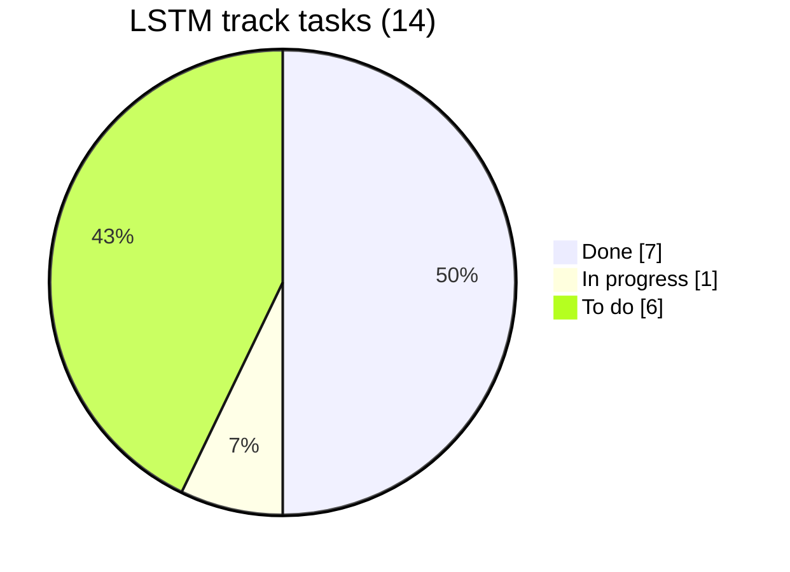
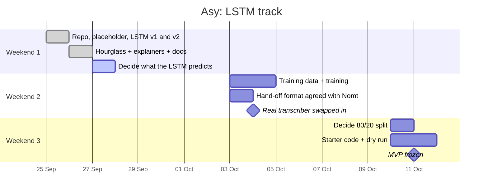
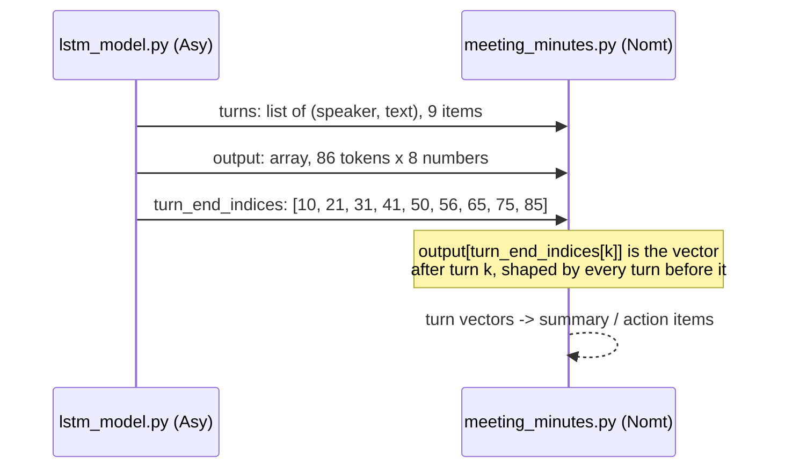

# Progress: Asy (LSTM track)

| | |
|---|---|
| **Owner** | Asy |
| **Track** | 2: LSTM (with Nomt, who owns meeting minutes) |
| **Code** | `prototype/transcript_placeholder.py`, `prototype/lstm_model.py` |
| **Last updated** | 26 Sep 2026 |
| **Current phase** | Weekend 1: build the pieces |

Update this file whenever something is finished, decided or blocked. Tick the box, add a line to the [log](#log), and move the node in the [roadmap](#roadmap).

---

## At a glance

| Area | Status | Note |
|---|---|---|
| Placeholder transcript | Done | Same contract the real transcriber will use |
| LSTM forward pass | Done | Continuous across all 9 turns |
| Hourglass architecture | Done | 8 / 16 / 32 / 16 / 8, adapted from Li et al. (2024) |
| What the LSTM should learn | In progress | Decide with Nomt |
| Training | To do | Needs a task and data first |
| Hand-off to Nomt | To do | Output shape is ready; format to agree |
| Real transcriber swap | To do | Waiting on Track 1 (Weekend 2) |

---

## Roadmap

```mermaid
flowchart LR
    A["Repo + Nomt added"]:::done --> B["Placeholder transcript"]:::done
    B --> C["LSTM v1<br/>per line"]:::done
    C --> D["LSTM v2<br/>continuous + eot"]:::done
    D --> E["Hourglass LSTM<br/>5 layers"]:::done
    E --> F["Explainers +<br/>README + push"]:::done
    F --> G["Decide what the<br/>LSTM predicts"]:::doing
    G --> H["Training data"]:::todo
    H --> I["Training"]:::todo
    G --> J["Hand-off format<br/>for Nomt"]:::todo
    I --> K["Swap in real<br/>transcriber"]:::todo
    J --> K
    K --> L["Decide 80/20 split"]:::todo
    L --> M["Freeze + dry run"]:::todo

    classDef done fill:#dcefe5,stroke:#1f8a5f,color:#1c1d1f
    classDef doing fill:#e4e9fc,stroke:#3457d5,color:#1c1d1f
    classDef todo fill:#f5f4f1,stroke:#9a9ca1,color:#1c1d1f,stroke-dasharray: 4 3
```

Green: done · Blue: in progress · Dashed: to do

---

## Timeline

Weekend dates are assumed (26 Sep, 3 Oct, 10 Oct). Change them here if the team's plan differs.

---

## Checklist

### Weekend 1: build the pieces

- [x] Create private repo `mlda-audio-workshop`, add Nomt as collaborator (25 Sep)
- [x] Placeholder transcript with the `get_transcript(audio_path=None) -> str` contract (25 Sep)
- [x] First NumPy LSTM forward pass, one line at a time (25 Sep)
- [x] Run the LSTM continuously across turns, with `<eot>` markers between speakers (25 Sep)
- [x] Restructure into a 5-layer hourglass LSTM, adapted from Li et al. (2024) (26 Sep)
- [x] Interactive explainers: *Minutes Pipeline* and *Inside the LSTM Cell* (26 Sep)
- [x] README, this tracker, and first push to GitHub (26 Sep)
- [ ] Decide what the LSTM should learn (with Nomt), see [open questions](#open-questions)

### Weekend 2: connect

- [ ] Choose or create training data
- [ ] Add training (NumPy backprop through time, or move training to PyTorch/Keras on Colab)
- [ ] Agree the hand-off format with Nomt (see [hand-off](#hand-off-to-nomt))
- [ ] Swap the placeholder for Track 1's real transcriber and run the full chain once

### Weekend 3: freeze

- [ ] Decide which 20% participants complete, and the Part A/B split for the extension
- [ ] Write participant starter code and a debug-time cheat sheet
- [ ] Dry run with someone outside the LSTM track, then freeze

---

## Log

### Fri 25 Sep 2026

- Created private repo `Asyxddiq/mlda-audio-workshop`; Nomt added as collaborator.
- Built `transcript_placeholder.py`: a 9-turn sample meeting behind `get_transcript()`, so the LSTM track isn't blocked on the transcriber.
- Built LSTM v1 in plain NumPy (PyTorch wasn't installable in the build sandbox, and NumPy keeps the gates visible for teaching).
- Changed to one continuous pass over the whole conversation. Long-range memory across turns is the reason to teach LSTM at all, and v1 reset state at every line.

### Sat 26 Sep 2026

- Checked the "deep research" summary against the actual paper PDF: the summary described a different CNN + LSTM sound-classification model. Worked from the actual paper instead.
- Adapted the paper's hourglass: 5 layers (8 / 16 / 32 / 16 / 8 units over 88 / 44 / 22 / 44 / 88 steps), lossless fold and unfold, skips 1→5 and 2→4, no attention gates.
- Noted two things in the code: the paper's "1014 units" is almost certainly a typo for 1024, and folding lets a word see up to 3 words ahead (fine for minutes).
- Built two interactive explainers using the real numbers from the run.
- Wrote README and this tracker; pushed prototype to GitHub.
- Observation: with random weights every forget gate sits near 0.49, so almost nothing survives 47 words in layer 1. Training is what would fix this. It's a good example for the workshop.

<!-- Add new entries above this line, newest date last. -->

---

## Decisions

| Date | Decision | Why |
|---|---|---|
| 25 Sep | Plain NumPy, no ML framework | Gates stay visible as maths; runs on free Colab with nothing to install |
| 25 Sep | One continuous sequence, never reset between turns | Long-range memory across turns is the concept being taught |
| 25 Sep | Insert `<eot>` between turns | Gives the model a signal that the speaker changed |
| 26 Sep | Hourglass layout from Li et al. (2024), simplified | Real, citable architecture; shorter path for memory in the neck |
| 26 Sep | Skips add; no attention gates | Easier for beginners; attention can be a stretch topic |
| 26 Sep | `meeting_minutes.py` kept out of the repo | Nomt owns the minutes step; avoid giving him a conflicting starting point |

---

## Open questions

- [ ] **What should the LSTM predict?** Options: label each turn (action item vs discussion), score how important each turn is for the summary, or predict the next word. This drives the training data.
- [ ] **Where does training data come from?** Hand-label a few sample meetings, or use a public meeting corpus?
- [ ] **Minutes format:** summary, action items, or both? (Also asked in the 3-weekend plan doc.)
- [ ] **Training in NumPy or a framework?** Hand-written backprop is heavy for beginners; training in PyTorch/Keras on Colab while keeping NumPy for the teaching forward pass is an option.
- [ ] **Which 20% do participants complete** in the first hands-on demo, and what is Part A vs Part B in the extension?

---

## Hand-off to Nomt

What `lstm_model.py` already gives the meeting-minutes step:

| Item | Shape / type | Status |
|---|---|---|
| `turns` | list of `(speaker, text)` | Ready |
| `output` | NumPy array `(num_tokens, 8)` | Ready (untrained values) |
| `turn_end_indices` | list of int, one per turn | Ready |
| A function Nomt can import instead of running `main` | e.g. `run_pipeline() -> (turns, output, turn_end_indices)` | To agree |

---

## Next up

1. Sit down with Nomt: pick what the LSTM predicts, and the minutes format.
2. Wrap the `main` block in an importable `run_pipeline()` so Nomt can call it.
3. Pick training data, then decide NumPy vs framework for training.
