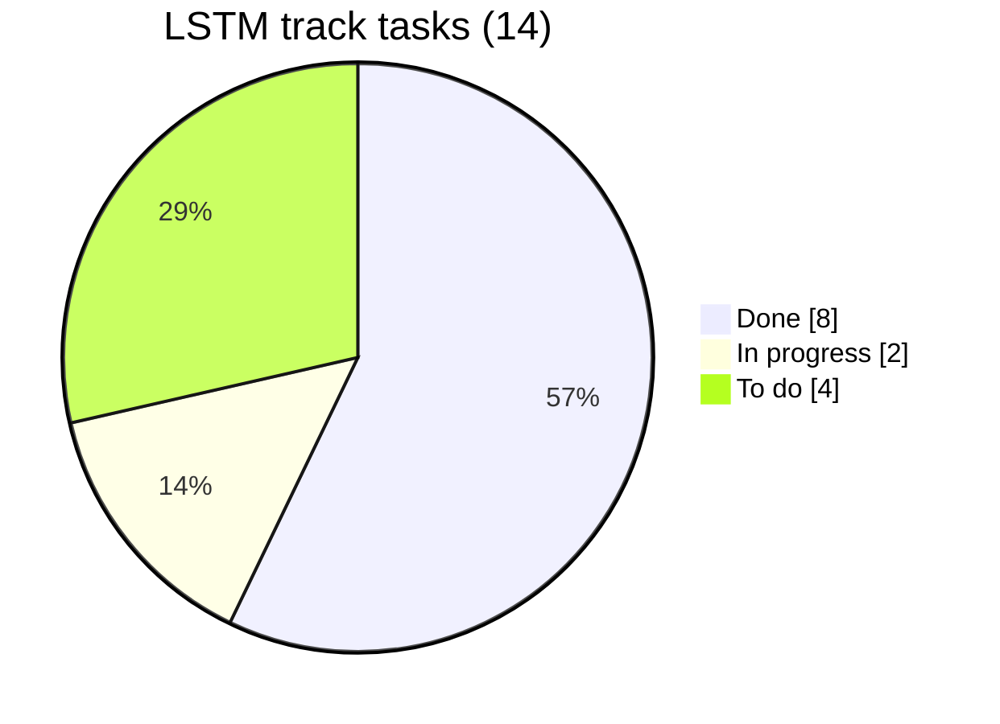
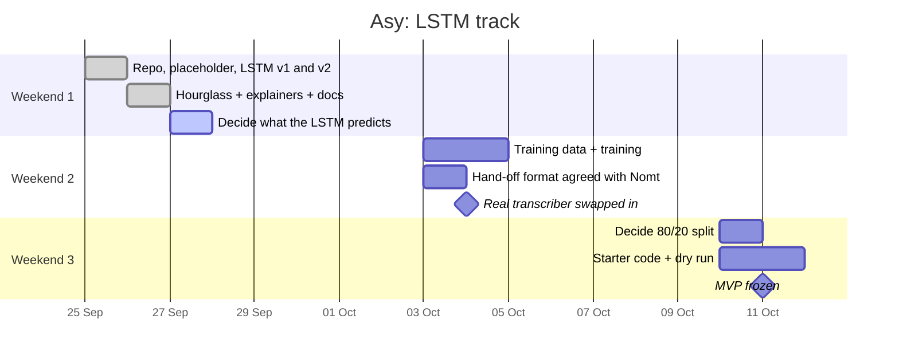
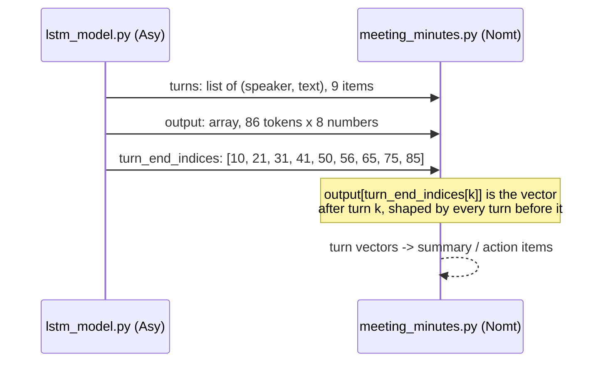

# Progress: Asy (LSTM track)

| | |
|---|---|
| **Owner** | Asy |
| **Track** | 2: LSTM (with Nomt, who owns meeting minutes) |
| **Code** | `prototype/transcript_placeholder.py`, `prototype/lstm_model.py` |
| **Last updated** | 27 Sep 2026 |
| **Current phase** | Weekend 1 → 2: pieces built, training scaffolded |

Update this file whenever something is finished, decided or blocked. Tick the box, add a line to the [log](#log), and move the node in the [roadmap](#roadmap).

---

## At a glance

| Area | Status | Note |
|---|---|---|
| Placeholder transcript | Done | Same contract the real transcriber will use |
| LSTM forward pass | Done | Continuous across all 9 turns |
| Hourglass architecture | Done | 8 / 16 / 32 / 16 / 8, adapted from Li et al. (2024) |
| What the LSTM should learn | Done | Per-turn classifier: action_item / decision / discussion (see [decisions](#decisions)) |
| Training | In progress | PyTorch scaffold runs on Colab; ~100-turn dataset is Weekend 2 |
| Hand-off to Nomt | Done | `run_pipeline()` added; format agreed |
| Labelling guide + rule | In progress | Draft stub written; action-item rule pending Asy |
| Real transcriber swap | To do | Waiting on Track 1 (Weekend 2) |

---

## Roadmap

```mermaid
flowchart LR
    A["Repo + Nomt added"]:::done --> B["Placeholder transcript"]:::done
    B --> C["LSTM v1<br/>per line"]:::done
    C --> D["LSTM v2<br/>continuous + eot"]:::done
    D --> E["Hourglass LSTM<br/>5 layers"]:::done
    E --> F["Explainers +<br/>README + push"]:::done
    F --> G["Decide what the<br/>LSTM predicts"]:::doing
    G --> H["Training data"]:::todo
    H --> I["Training"]:::todo
    G --> J["Hand-off format<br/>for Nomt"]:::todo
    I --> K["Swap in real<br/>transcriber"]:::todo
    J --> K
    K --> L["Decide 80/20 split"]:::todo
    L --> M["Freeze + dry run"]:::todo

    classDef done fill:#dcefe5,stroke:#1f8a5f,color:#1c1d1f
    classDef doing fill:#e4e9fc,stroke:#3457d5,color:#1c1d1f
    classDef todo fill:#f5f4f1,stroke:#9a9ca1,color:#1c1d1f,stroke-dasharray: 4 3
```

Green: done · Blue: in progress · Dashed: to do

---

## Timeline

Weekend dates are assumed (26 Sep, 3 Oct, 10 Oct). Change them here if the team's plan differs.

---

## Checklist

### Weekend 1: build the pieces

- [x] Create private repo `mlda-audio-workshop`, add Nomt as collaborator (25 Sep)
- [x] Placeholder transcript with the `get_transcript(audio_path=None) -> str` contract (25 Sep)
- [x] First NumPy LSTM forward pass, one line at a time (25 Sep)
- [x] Run the LSTM continuously across turns, with `<eot>` markers between speakers (25 Sep)
- [x] Restructure into a 5-layer hourglass LSTM, adapted from Li et al. (2024) (26 Sep)
- [x] Interactive explainers: *Minutes Pipeline* and *Inside the LSTM Cell* (26 Sep)
- [x] README, this tracker, and first push to GitHub (26 Sep)
- [x] Decide what the LSTM should learn (with Nomt): per-turn classifier, action_item / decision / discussion (27 Sep)

### Weekend 2: connect

- [x] Wrap `main` in an importable `run_pipeline()` for the minutes step (27 Sep)
- [x] Scaffold `train_classifier.py`: PyTorch, one hand-labelled meeting, loop runs + times an epoch (27 Sep)
- [ ] Write the one-page labelling guide with Asy; lock the action-item rule (request / acceptance / both)
- [ ] Choose or create training data: ~100 turns across meeting types, 50/50 (Nomt: CCA + club; Asy: group project + lab stand-up)
- [ ] Train on the full set in PyTorch/Colab; keep NumPy for the teaching forward pass; port weights back for parity
- [ ] Swap the placeholder for Track 1's real transcriber and run the full chain once

### Weekend 3: freeze

- [ ] Decide which 20% participants complete, and the Part A/B split for the extension
- [ ] Write participant starter code and a debug-time cheat sheet
- [ ] Dry run with someone outside the LSTM track, then freeze

---

## Log

### Fri 25 Sep 2026

- Created private repo `Asyxddiq/mlda-audio-workshop`; Nomt added as collaborator.
- Built `transcript_placeholder.py`: a 9-turn sample meeting behind `get_transcript()`, so the LSTM track isn't blocked on the transcriber.
- Built LSTM v1 in plain NumPy (PyTorch wasn't installable in the build sandbox, and NumPy keeps the gates visible for teaching).
- Changed to one continuous pass over the whole conversation. Long-range memory across turns is the reason to teach LSTM at all, and v1 reset state at every line.

### Sat 26 Sep 2026

- Checked the "deep research" summary against the actual paper PDF: the summary described a different CNN + LSTM sound-classification model. Worked from the actual paper instead.
- Adapted the paper's hourglass: 5 layers (8 / 16 / 32 / 16 / 8 units over 88 / 44 / 22 / 44 / 88 steps), lossless fold and unfold, skips 1→5 and 2→4, no attention gates.
- Noted two things in the code: the paper's "1014 units" is almost certainly a typo for 1024, and folding lets a word see up to 3 words ahead (fine for minutes).
- Built two interactive explainers using the real numbers from the run.
- Wrote README and this tracker; pushed prototype to GitHub.
- Observation: with random weights every forget gate sits near 0.49, so almost nothing survives 47 words in layer 1. Training is what would fix this. It's a good example for the workshop.

### Sun 27 Sep 2026

- Settled the core plan with Asy (see [decisions](#decisions)): train the hourglass **itself** as a per-turn classifier (action_item / decision / discussion), keyword rules first as baseline + fallback, PyTorch on Colab for training with NumPy kept for the teaching forward pass.
- Added `run_pipeline()` to `lstm_model.py` (importable hand-off) and a first `meeting_minutes.py` (Markdown minutes: Decisions + Action Items) that runs on a hand-labelled stub.
- Scaffolded `train_classifier.py`: mirrors the 4-gate cell in PyTorch (not `nn.LSTM`), trainable embeddings with a fixed vocab + `<unk>`, float64 for weight-port parity. Runs on one hand-labelled meeting to prove the loop and time an epoch. Colab-only (PyTorch isn't installable in the build sandbox).
- Two calls still **proposed, pending Asy**: the action-item labelling rule (request / acceptance / both — we lean toward *both, merged in rendering*), and a curated cross-turn *probe set* for the held-out comparison. Detail lives in the new labelling guide.
- Note: the scaffold's `GOLD_LABELS` and `meeting_minutes.py`'s stub still use request-only labelling; both need updating together once the action-item rule is locked.

<!-- Add new entries above this line, newest date last. -->

---

## Decisions

| Date | Decision | Why |
|---|---|---|
| 25 Sep | Plain NumPy, no ML framework | Gates stay visible as maths; runs on free Colab with nothing to install |
| 25 Sep | One continuous sequence, never reset between turns | Long-range memory across turns is the concept being taught |
| 25 Sep | Insert `<eot>` between turns | Gives the model a signal that the speaker changed |
| 26 Sep | Hourglass layout from Li et al. (2024), simplified | Real, citable architecture; shorter path for memory in the neck |
| 26 Sep | Skips add; no attention gates | Easier for beginners; attention can be a stretch topic |
| 26 Sep | `meeting_minutes.py` kept out of the repo | Nomt owns the minutes step; avoid giving him a conflicting starting point |
| 27 Sep | Train the hourglass **itself** as a per-turn classifier (action_item / decision / discussion), not a separate LSTM | A separate LSTM would leave the hourglass as decoration; the architecture we teach should be the one that does the work |
| 27 Sep | Keyword rules shipped first, as baseline **and** runtime fallback | Unblocks the pipeline now; doubles as the "where rules break" teaching contrast |
| 27 Sep | Train in PyTorch on Colab; NumPy hourglass stays forward-pass-only for teaching. Mirror the 4-gate cell (not `nn.LSTM`); float64 for weight-port parity | Autograd handles training; `nn.LSTM`'s packed gates make porting fiddly; NumPy stays readable |
| 27 Sep | Trainable embeddings, with a **fixed** training vocab + `<unk>` token | Teaches that embeddings are learned too; `<unk>` stops unseen words (held-out / *Try and test*) crashing. Not framed as "learns meaning" — too little data for that |
| 27 Sep | Seed ~15–20% of training turns with cross-turn-dependent labels (e.g. "Sure." after a request) | Gives the hourglass an honest reason to exist; keyword rules provably can't catch these |
| 27 Sep | ~100 hand-labelled turns across meeting types, 50/50 — Nomt: CCA committee + club event; Asy: group project + lab stand-up. Split train/held-out **by meeting** | Variety covers participants' likely contexts; splitting individual turns leaks vocab/state and inflates held-out scores |
| 27 Sep | Evaluate with per-label / confusion matrix; beat **both** the majority-class and keyword baselines | Most turns are "discussion", so plain accuracy flatters the model |
| 27 Sep | The graded 20% is done on **one shared meeting**; participants' own context lives only in *Try and test*, with keyword rules as the fallback there | 30 people each training/debugging their own data in one session would break debug time |
| 27 Sep | Minutes format: Markdown — Decisions + Action Items | Matches the repo's Markdown-first docs; short and demo-friendly |
| 27 Sep | **[PROPOSED, pending Asy]** Label action items on **both** the request and the acceptance; merge the pair in rendering (task + deadline from the request, owner from the acceptor) | Task and owner live in different turns; also creates the keyword-free acceptance turns that need memory. Final rule goes in the [labelling guide](labelling_guide.md) |
| 27 Sep | **[PROPOSED, pending Asy]** A curated held-out cross-turn **probe set** (8–10 examples), reported as its own scored slice next to the baselines | The "hourglass earns its keep" claim is too small/noisy to rest on aggregate held-out accuracy |

---

## Open questions

- [x] **What should the LSTM predict?** RESOLVED (27 Sep): per-turn classification — action_item / decision / discussion — by training the hourglass itself. See [decisions](#decisions).
- [x] **Where does training data come from?** RESOLVED (27 Sep): ~100 hand-labelled turns across meeting types, 50/50 with Asy. See [decisions](#decisions).
- [x] **Minutes format:** RESOLVED (27 Sep): Markdown — Decisions + Action Items.
- [x] **Training in NumPy or a framework?** RESOLVED (27 Sep): PyTorch on Colab for training, NumPy kept for the teaching forward pass.
- [ ] **Action-item labelling rule:** request, acceptance, or both? Leaning toward *both, merged in rendering* — pending Asy and the [labelling guide](labelling_guide.md).
- [ ] **Cross-turn probe set:** how many examples, and which held-out meetings carry them? Pending Asy.
- [ ] **Which 20% do participants complete** in the first hands-on demo (classifier forward pass, the minutes formatter, or one short training run), and what is Part A vs Part B in the extension? Now scoped to *one shared meeting* (decided); exact missing piece still open.

---

## Hand-off to Nomt

What `lstm_model.py` already gives the meeting-minutes step:

| Item | Shape / type | Status |
|---|---|---|
| `turns` | list of `(speaker, text)` | Ready |
| `output` | NumPy array `(num_tokens, 8)` | Ready (untrained values) |
| `turn_end_indices` | list of int, one per turn | Ready |
| A function Nomt can import instead of running `main` | `run_pipeline() -> (turns, output, turn_end_indices)` | Ready (added 27 Sep) |

---

## Next up

1. Write the one-page [labelling guide](labelling_guide.md) with Asy and lock the action-item rule (request / acceptance / both); each label 10 of the other's turns to check agreement.
2. Once the rule is locked, update `train_classifier.py`'s `GOLD_LABELS`, `meeting_minutes.py`'s stub, and add the request→acceptance merge to the renderer — together, so they stay consistent.
3. Build the ~100-turn dataset across meeting types (50/50), then train on Colab and port the weights back into the NumPy hourglass for parity.
